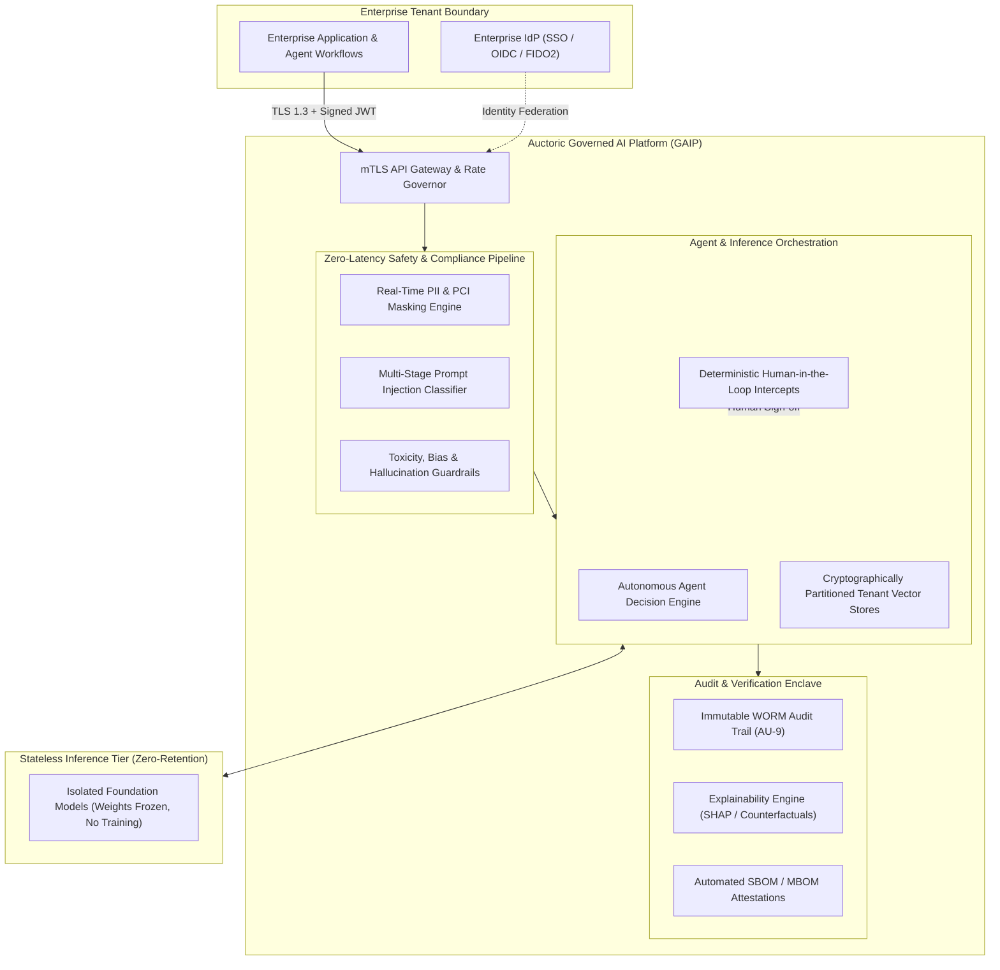

# Auctoric Governed AI-as-a-System Compliance Framework

[](#master-compliance-matrix)
[](docs/security-trust/information-security-policy.md)
[](docs/ai-governance/iso-42001-eu-ai-act-policy.md)
[](.well-known/security.txt)

---

## 1. Executive Platform Overview

**Auctoric** delivers a mission-critical **Governed AI-as-a-System (GAIP)** platform engineered for high-consequence enterprise, public sector, healthcare, and financial environments.

While foundational models provide cognitive capabilities, enterprises cannot deploy unconstrained, non-deterministic machine learning systems without deterministic safety boundaries, cryptographic auditability, data sovereignty guarantees, and multi-jurisdictional regulatory alignment.

The **Auctoric Platform** bridges this trust gap by wrapping foundation models, retrieval-augmented generation (RAG) pipelines, and autonomous agent swarms in an immutable governance envelope:



### Core Architecture Pillars
* **Zero Model Training on Customer Data:** Legally and architecturally guaranteed isolation ensuring customer prompts, inputs, vector embeddings, and outputs are never ingested into foundation models.
* **Deterministic Guardrails with Ephemeral Execution:** Real-time token filtering in volatile memory with immediate post-inference purging.
* **Continuous Regulatory Attestation:** Comprehensive adherence to international AI governance, defense cybersecurity, and healthcare standards.

---

## 2. Master Compliance Matrix

The following matrix maps Auctoric’s architectural, administrative, and legal controls across globally recognized regulatory frameworks, certification standards, and technical benchmarks:

| Compliance Framework / Standard | Governing Body / Jurisdiction | Primary Regulatory Scope | Auctoric Compliance Posture | Core Governing Documentation |
| :--- | :--- | :--- | :---: | :--- |
| **ISO/IEC 42001:2023** | ISO / IEC (Global) | Artificial Intelligence Management System (AIMS) | **Certified / Fully Aligned** | [ISO 42001 & EU AI Act Policy](docs/ai-governance/iso-42001-eu-ai-act-policy.md) |
| **EU AI Act (Reg (EU) 2024/1689)** | European Parliament / EU AI Office | Risk-based AI regulation, High-Risk AI conformity | **Conformant** | [ISO 42001 & EU AI Act Policy](docs/ai-governance/iso-42001-eu-ai-act-policy.md), [ADM Notice](docs/ai-governance/automated-decision-making-notice.md) |
| **NIST AI RMF 1.0** | NIST / U.S. Dept. of Commerce | AI Risk Management Framework (Govern, Map, Measure, Manage) | **Fully Aligned** | [Responsible AI & Ethics Statement](docs/ai-governance/responsible-ai-ethics-statement.md) |
| **OWASP LLM Top 10 (2025/2026)** | OWASP Foundation | Vulnerabilities in Large Language Model Applications | **Mitigated at Runtime** | [SSDLC Policy](docs/technical-standards/ssdlc-policy.md), [Shared Responsibility Matrix](docs/security-trust/shared-responsibility-matrix.md) |
| **SOC 2 Type II** | AICPA (United States) | Trust Services Criteria (Security, Availability, Confidentiality, Privacy) | **Annual Audited Attestation** | [System Security Plan (SSP) Summary](docs/security-trust/system-security-plan-summary.md) |
| **ISO/IEC 27001:2022** | ISO / IEC (Global) | Information Security Management System (ISMS) | **Certified** | [Information Security Policy](docs/security-trust/information-security-policy.md) |
| **FedRAMP (Moderate Equivalent)** | FedRAMP PMO / GSA | Cloud security baseline for US federal agencies (NIST SP 800-53 Rev. 5) | **Moderate Baseline Implemented** | [System Security Plan (SSP) Summary](docs/security-trust/system-security-plan-summary.md) |
| **CMMC 2.0 (Level 2)** | U.S. Department of Defense | Cybersecurity Maturity Model Certification (CUI Protection) | **Level 2 Control Set Active** | [System Security Plan (SSP) Summary](docs/security-trust/system-security-plan-summary.md) |
| **HIPAA / HITECH Act** | HHS / OCR (United States) | Safeguards for electronic Protected Health Information (ePHI) | **BAA Supported / Compliant** | [HIPAA Business Associate Agreement](docs/sector-compliance/hipaa-baa.md) |
| **GDPR / UK GDPR** | European Union / UK ICO | Data privacy, processor obligations, international transfers, ADM | **Fully Compliant** | [DPA with SCCs](docs/legal/data-processing-addendum.md), [Privacy Policy](docs/legal/global-privacy-policy.md) |
| **FBI CJIS Security Policy** | Federal Bureau of Investigation | Criminal Justice Information (CJI) protection | **MCA / Addendum Ready** | [CJIS Security Addendum & MCA](docs/sector-compliance/cjis-security-addendum-mca.md) |
| **PCI-DSS v4.0.1** | PCI Security Standards Council | Cardholder Data Environment protection | **SAQ-A / Edge Redaction** | [PCI-DSS Matrix & AoC Summary](docs/security-trust/pci-dss-matrix-aoc.md) |
| **WCAG 2.2 Level AA** | W3C / WAI (Global) | Web Content Accessibility Guidelines | **Supports** | [VPAT / Section 508 / WCAG Statement](docs/accessibility/vpat-wcag22aa-section508.md) |
| **Section 508** | U.S. Access Board / Rehabilitation Act | Federal accessibility conformance for IT products | **Supports (VPAT 2.5)** | [VPAT / Section 508 / WCAG Statement](docs/accessibility/vpat-wcag22aa-section508.md) |

---

## 3. Repository Directory Structure & Direct Document Links

This repository contains modular, audit-ready compliance policies, contractual agreements, and technical engineering standards:

```
auctoric-compliance-framework/
├── .gitignore                                   # Standard repository exclusions
├── .well-known/
│   └── security.txt                             # RFC 9116 vulnerability contact metadata
├── README.md                                    # Master framework index & executive overview
└── docs/
    ├── legal/                                   # Commercial, customer & privacy contracts
    │   ├── master-services-agreement.md         # Master enterprise subscription terms
    │   ├── terms-of-service.md                  # Web console & developer terms of service
    │   ├── global-privacy-policy.md             # Comprehensive GDPR/CCPA privacy notice
    │   ├── acceptable-use-policy.md             # Platform guardrails & safety restrictions
    │   └── data-processing-addendum.md          # Art. 28 GDPR DPA with EU/UK SCCs
    ├── ai-governance/                           # AI-specific safety, ethics & statutory policies
    │   ├── iso-42001-eu-ai-act-policy.md        # Comprehensive AIMS & EU AI Act governance
    │   ├── ai-dpa-model-non-retention-addendum.md# Model non-retention & customer IP covenant
    │   ├── responsible-ai-ethics-statement.md   # Core principles & ethical red-lines
    │   └── automated-decision-making-notice.md  # ADM logic, explainability & consumer rights
    ├── security-trust/                          # Enterprise cybersecurity & trust frameworks
    │   ├── information-security-policy.md       # ISO 27001 / SOC 2 Information Security Policy
    │   ├── shared-responsibility-matrix.md      # CSP vs. Auctoric vs. Customer RACI model
    │   ├── system-security-plan-summary.md      # FedRAMP / NIST SP 800-53 Rev 5 SSP overview
    │   └── pci-dss-matrix-aoc.md                # PCI-DSS v4.0.1 responsibility matrix & AoC
    ├── sector-compliance/                       # Regulated industry compliance instruments
    │   ├── hipaa-baa.md                         # Business Associate Agreement for ePHI
    │   └── cjis-security-addendum-mca.md        # FBI CJIS Management Control Agreement & Addendum
    ├── technical-standards/                     # Engineering, supply chain & disclosure policies
    │   ├── ssdlc-policy.md                      # Secure SDLC, threat modeling & CI/CD gates
    │   ├── vulnerability-disclosure-policy.md   # Coordinated vulnerability disclosure & Safe Harbor
    │   └── sbom-mbom-guidelines.md              # CycloneDX SBOM & Model BOM architecture
    ├── accessibility/                           # Accessibility standards & procurement filings
    │   └── vpat-wcag22aa-section508.md          # Voluntary Product Accessibility Template (VPAT 2.5)
    └── governance/                              # Corporate ethics, reporting & whistleblower safeguards
        ├── code-of-ethics.md                    # Code of Ethics and Business Conduct
        └── whistleblower-policy.md              # Whistleblower protections & hotline procedures
```

### Complete Document Index

#### 📜 Legal Documents
* [Master Services Agreement (MSA)](docs/legal/master-services-agreement.md) — Enterprise subscription terms, AI warranties, intellectual property allocations, and liability terms.
* [Terms of Service (ToS)](docs/legal/terms-of-service.md) — Self-service developer and API access conditions, rate quotas, and acceptable usage rules.
* [Global Privacy Policy](docs/legal/global-privacy-policy.md) — Comprehensive privacy disclosures covering GDPR, CCPA/CPRA, and international data transfers.
* [Acceptable Use Policy (AUP)](docs/legal/acceptable-use-policy.md) — Prohibited AI use cases, EU AI Act banned practices, and abuse reporting.
* [Data Processing Addendum (DPA) with SCCs](docs/legal/data-processing-addendum.md) — Article 28 GDPR processor agreement including Standard Contractual Clauses (Modules 2 & 3).

#### 🤖 AI Governance Documents
* [ISO 42001 & EU AI Act Governance Policy](docs/ai-governance/iso-42001-eu-ai-act-policy.md) — Artificial Intelligence Management System (AIMS) manual and EU AI Act conformity.
* [AI DPA & Model Non-Retention Addendum](docs/ai-governance/ai-dpa-model-non-retention-addendum.md) — Legally binding zero-training covenants and custom model IP guarantees.
* [Responsible AI & Ethics Statement](docs/ai-governance/responsible-ai-ethics-statement.md) — Foundational ethical commitments, human-in-the-loop oversight, and absolute red lines.
* [Automated Decision-Making (ADM) Notice](docs/ai-governance/automated-decision-making-notice.md) — Transparency notice detailing algorithmic explainability and human contestability rights.

#### 🛡️ Security & Trust Documents
* [Information Security Policy (ISP)](docs/security-trust/information-security-policy.md) — Enterprise security policy covering Zero Trust, MFA, cryptography, and DR.
* [Shared Responsibility Matrix](docs/security-trust/shared-responsibility-matrix.md) — Comprehensive tripartite matrix delineating Cloud Provider, Auctoric, and Customer obligations.
* [System Security Plan (SSP) Summary](docs/security-trust/system-security-plan-summary.md) — FedRAMP Moderate / NIST SP 800-53 Rev. 5 authorization boundary summary.
* [PCI-DSS Matrix & AoC Summary](docs/security-trust/pci-dss-matrix-aoc.md) — PCI-DSS v4.0.1 scoping, tokenized payment flows, and edge cardholder redaction.

#### 🏛️ Sector-Specific Compliance
* [HIPAA Business Associate Agreement (BAA)](docs/sector-compliance/hipaa-baa.md) — Statutory safeguards and non-training guarantees for electronic Protected Health Information (ePHI).
* [CJIS Security Addendum & Management Control Agreement (MCA)](docs/sector-compliance/cjis-security-addendum-mca.md) — FBI CJIS compliance for law enforcement agency deployments.

#### ⚙️ Technical Standards & Engineering
* [Secure Software Development Lifecycle (SSDLC) Policy](docs/technical-standards/ssdlc-policy.md) — Shift-left engineering controls, CI/CD gates, and AI adversarial red teaming.
* [Vulnerability Disclosure Policy (VDP)](docs/technical-standards/vulnerability-disclosure-policy.md) — ISO 29147 coordinated disclosure policy with legal Safe Harbor.
* [SBOM and MBOM Architecture Guidelines](docs/technical-standards/sbom-mbom-guidelines.md) — CycloneDX v1.6 supply chain specifications for software and model weights.

#### ♿ Accessibility
* [Accessibility Conformance Statement (VPAT / WCAG 2.2 AA / Section 508)](docs/accessibility/vpat-wcag22aa-section508.md) — Formal VPAT 2.5 accessibility evaluation.

#### ⚖️ Corporate Governance
* [Code of Ethics & Business Conduct](docs/governance/code-of-ethics.md) — Corporate ethical rules, anti-corruption (FCPA), and asset protection standards.
* [Whistleblower & Non-Retaliation Policy](docs/governance/whistleblower-policy.md) — Confidential 24/7 reporting channels and strict anti-retaliation protections.

---

## 4. Operational Inquiries & Contacts

| Contact Office | Focus Area | Contact Channel |
| :--- | :--- | :--- |
| **Chief AI Governance Officer (CAIGO)** | ISO 42001, EU AI Act, Algorithmic Ethics | `[caigo@auctoric.ai]` |
| **Chief Information Security Officer (CISO)** | Security Architecture, Vulnerability Inquiries | `[ciso@auctoric.ai]` |
| **Data Protection Officer (DPO)** | GDPR, Privacy, International Data Transfers | `[dpo@auctoric.ai]` |
| **Vulnerability Disclosures** | RFC 9116 Coordinated Disclosure Intake | [security.txt](.well-known/security.txt) / `[security@auctoric.ai]` |
| **Whistleblower Intake Hotline** | Anonymous 24/7 Ethics & Misconduct Reporting | `[https://auctoric.ethicspoint.com]` / `[+1 (800) 555-ETHX]` |
