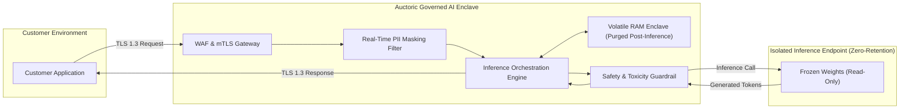

# AI Data Processing & Model Non-Retention Addendum

**Document Reference:** AUC-AIG-ADD-001  
**Version:** 2.3  
**Effective Date:** `[Insert Effective Date]`  
**Last Updated:** October 22, 2026  
**Classification:** Legal / AI Governance  
**Companion Documents:** [Master Services Agreement](../legal/master-services-agreement.md) | [Data Processing Addendum](../legal/data-processing-addendum.md) | [Schedule 1: AI Service-Specific Terms](../legal/ai-service-specific-terms.md)

---

This AI Data Processing & Model Non-Retention Addendum ("**AI Addendum**") supplements the Master Services Agreement and Data Processing Addendum entered into between **Auctoric, LLC** ("**Auctoric**") and the contracting customer entity ("**Customer**").

This AI Addendum establishes legally binding safeguards and technical guarantees regarding the isolation, processing, non-retention, and intellectual property ownership of Customer Content within the Auctoric AI Platform.

---

## 1. Zero Model Training & Non-Retention Commitment

### 1.1 Strict Prohibition on Public Model Training
Auctoric contractually guarantees and warrants that:
1. **No Foundation Model Training:** Auctoric will NOT use Customer Content (including prompts, inputs, vector embeddings, context attachments, synthetic data, agent execution traces, or generated outputs) to train, retrain, pre-train, RLHF (reinforcement learning from human feedback), DPO (direct preference optimization), or distill any public, multi-tenant, or foundational AI models.
2. **Third-Party Model Isolation:** When Auctoric orchestrates inference via third-party foundation model APIs (e.g., Google Cloud Vertex AI, Microsoft Azure OpenAI, Anthropic Claude), Auctoric utilizes enterprise-tier zero-data-retention (ZDR) endpoints where providers are bound not to train on Customer inputs or outputs.

### 1.2 Ephemeral Processing Enclaves
By default, real-time inference processing operates in volatile memory enclaves. Customer Content (prompts and completions) is not retained in persistent model storage following completion of the response, unless Customer explicitly configures persistent audit logging or custom storage buckets. Non-content operational telemetry (token counts, latency, and cryptographic audit hashes) is retained for billing and security monitoring.

---

## 2. Customer Fine-Tuned Models & Custom Adapters

### 2.1 Ownership of Customization Artifacts
Where Customer engages Auctoric Services to train parameter-efficient fine-tuning (PEFT) adapters (e.g., LoRA, QLoRA) or generate specialized vector embeddings:
* **Customer Ownership of Adapters:** Customer retains exclusive intellectual property ownership, title, and interest in newly created fine-tuning adapters, LoRA matrices, and embeddings generated specifically for Customer from Customer Content.
* **Underlying Provider IP:** Pre-existing foundational models, base weights, and provider-managed model architectures remain subject to their applicable third-party license terms (such as Google Vertex AI Modified Model terms).
* **Cryptographic Isolation:** Custom model weights and adapters are encrypted with dedicated keys (including Customer-Managed Encryption Keys (CMEK) where supported). No other tenant can access or decrypt these weights.

### 2.2 Model Portability, Deprovisioning, and Sanitization
Upon thirty (30) days' written notice or upon termination of the Services:
1. Customer may request an export of extractable, customer-owned parameter adapters (e.g., LoRA matrices) within thirty (30) calendar days;
2. Following such 30-day export window, or upon customer's confirmed completion of export, Auctoric will permanently deprovision and sanitize all instances of the custom model artifacts within thirty (30) calendar days (total maximum 60 days from termination), in accordance with NIST SP 800-88 Revision 2 media sanitization standards.

---

## 3. Retrieval-Augmented Generation (RAG) and Vector Stores

### 3.1 Namespace Isolation
All vector embeddings, chunked document indexes, and semantic search stores maintained in the Auctoric Knowledge Engine are logically and cryptographically partitioned at the tenant database level.

### 3.2 Access Token Scoping
Downstream autonomous agents querying vector stores operate under strict OAuth 2.0 / RBAC tokens scoping queries only to Customer’s authorized organizational indexes.

---

## 4. Technical Safeguards & Architecture

### 4.1 Cryptographic Controls
* All network traffic is encrypted in transit using TLS 1.3 with forward secrecy.
* Static data at rest is encrypted using AES-256 with automated key management.

### 4.2 Automated PII Redaction
Customer may activate Auctoric’s real-time PII Redactor, which masks credit card numbers, Social Security Numbers, phone numbers, and protected health information (PHI) before prompts hit downstream model inference.

---

## 5. Control Verification and Compliance Alignment

Auctoric designs and operates its technical safeguards to comply with the criteria established by **ISO/IEC 42001:2023 (AIMS)**, **ISO/IEC 27001:2022**, and **SOC 2 Type II (Security and Privacy Trust Services Criteria)**. Auctoric maintains documented policies, evidence logs, and testing summaries verifying adherence to these non-retention and data isolation commitments.

---

## 6. Model Inversion & AI Security Incidents

In addition to the breach notifications specified in the DPA, Auctoric will notify Customer within **twenty-four (24) hours** of becoming aware of:
1. Any verified model extraction, inversion, or gradient reconstruction attack targeting Customer’s dedicated models or vector embeddings;
2. Any confirmed prompt injection exploit that bypassed perimeter guardrails and exfiltrated Customer Content across tenant boundaries.

---

**IN WITNESS WHEREOF**, the parties have executed this AI Data Processing & Model Non-Retention Addendum.

| **For Auctoric, LLC** | **For [Customer Legal Name]** |
| :--- | :--- |
| **Signature:** ___________________________ | **Signature:** ___________________________ |
| **Name:** `[Authorized Officer Name]` | **Name:** `[Authorized Officer Name]` |
| **Title:** `[Chief AI Governance Officer / CISO]` | **Title:** `[Authorized Signatory Title]` |
| **Date:** `[Insert Date]` | **Date:** `[Insert Date]` |
