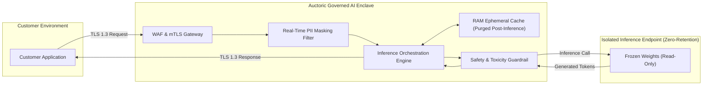

# AI Data Processing & Model Non-Retention Addendum

**Document Reference:** AUC-AIG-ADD-001  
**Version:** 2.2  
**Effective Date:** `[Insert Effective Date]`  
**Last Updated:** October 22, 2026  
**Classification:** Legal / AI Governance  
**Companion Documents:** [Master Services Agreement](../legal/master-services-agreement.md) | [Data Processing Addendum](../legal/data-processing-addendum.md)

---

This AI Data Processing & Model Non-Retention Addendum ("**AI Addendum**") supplements the Master Services Agreement and Data Processing Addendum entered into between **[Auctoric, Inc.]** ("**Auctoric**") and the contracting customer entity ("**Customer**").

This AI Addendum establishes legally binding safeguards and technical guarantees regarding the isolation, processing, non-retention, and intellectual property ownership of Customer Content within the Auctoric AI Platform.

---

## 1. Zero Model Training & Non-Retention Commitment

### 1.1 Strict Prohibition on Public Model Training
Auctoric contractually guarantees and warrants that:
1. **No Foundation Model Training:** Auctoric will NOT use Customer Content (including prompts, inputs, vector embeddings, context attachments, synthetic data, agent execution traces, or generated outputs) to train, retrain, pre-train, RLHF (reinforcement learning from human feedback), DPO (direct preference optimization), or distill any public, multi-tenant, or foundational AI models.
2. **Third-Party Model Isolation:** When Auctoric orchestrates inference via third-party foundation model APIs (e.g., Anthropic Claude, OpenAI, Mistral, Google Gemini), Auctoric utilizes enterprise-tier zero-data-retention (ZDR) endpoints where third-party providers are legally bound not to train on Customer inputs or outputs.

### 1.2 Ephemeral Inference Enclaves
By default, real-time inference processing operates in volatile random-access memory (RAM). Prompts and responses exist only for the millisecond duration necessary to generate the token stream and are purged immediately upon completion of the HTTP/gRPC connection, unless Customer explicitly activates persistent audit logging or custom storage buckets.

---

## 2. Customer Fine-Tuned Models & Custom Adapters

### 2.1 Ownership of Custom Model Artifacts
Where Customer engages Auctoric Services to fine-tune models, train parameter-efficient fine-tuning (PEFT) adapters (e.g., LoRA, QLoRA), or generate specialized vector embeddings:
* **Customer Ownership:** Customer retains exclusive intellectual property ownership, title, and interest in all fine-tuned weights, adapters, LoRA matrices, and embeddings generated specifically for Customer from Customer Content.
* **Cryptographic Isolation:** Custom model weights and adapters are encrypted with Customer-Managed Encryption Keys (CMEK) via AWS KMS, GCP KMS, or HashiCorp Vault. No other tenant, nor Auctoric personnel without explicit break-glass authorization, can access or decrypt these weights.

### 2.2 Model Portability and Deprovisioning
Upon thirty (30) days' written notice or upon termination of the Services, Customer may request an export of all custom weights, LoRA adapters, and embedding matrices. Upon confirmed export, Auctoric will permanently overwrite and deprovision all instances of the custom model within thirty (30) days in compliance with NIST SP 800-88 Rev 1.

---

## 3. Retrieval-Augmented Generation (RAG) and Vector Stores

### 3.1 Namespace Isolation
All vector embeddings, chunked document indexes, and semantic search stores maintained in the Auctoric Knowledge Engine are logically and cryptographically partitioned at the tenant database level.

### 3.2 Access Token Scoping
Downstream autonomous agents querying vector stores operate under strict OAuth 2.0 / RBAC tokens scoping queries only to Customer’s authorized organizational indexes.

---

## 4. Technical Safeguards & Architecture

### 4.1 Cryptographic Controls
* All network traffic is encrypted in transit using TLS 1.3 with ChaCha20-Poly1305 or AES-GCM cipher suites.
* Static data at rest is encrypted using AES-256 with automated annual key rotation.

### 4.2 Differential Privacy & Automated PII Masking
Customer may activate Auctoric’s real-time PII Redactor, which masks credit card numbers, Social Security Numbers, phone numbers, and protected health information (PHI) before prompts hit downstream model inference.

---

## 5. Audit Rights and Attestation

### 5.1 Third-Party Verification
Auctoric contracts an independent AICPA-accredited CPA firm to audit compliance with these model non-retention and data isolation controls as part of its annual SOC 2 Type II (Privacy & Security Criteria) and ISO/IEC 42001 (AIMS) certifications.

### 5.2 Attestation Delivery
Auctoric will provide Customer, upon written request and under non-disclosure agreement, the most recent SOC 2 Type II report and ISO 42001 conformity assessment verifying adherence to non-retention commitments.

---

## 6. Model Inversion & AI Security Incidents

In addition to the breach notifications specified in the DPA, Auctoric will notify Customer within **twenty-four (24) hours** if Auctoric confirms:
1. Any unauthorized model extraction, inversion, or gradient reconstruction attack targeting Customer’s dedicated models or vector embeddings;
2. Any prompt injection exploit that bypassed perimeter guardrails and exfiltrated Customer Content across tenant boundaries.

---

**IN WITNESS WHEREOF**, the parties have executed this AI Data Processing & Model Non-Retention Addendum.

| **For [Auctoric, Inc.]** | **For [Customer Legal Name]** |
| :--- | :--- |
| **Signature:** ___________________________ | **Signature:** ___________________________ |
| **Name:** `[Authorized Officer Name]` | **Name:** `[Authorized Officer Name]` |
| **Title:** `[Chief AI Governance Officer / CISO]` | **Title:** `[Authorized Signatory Title]` |
| **Date:** `[Insert Date]` | **Date:** `[Insert Date]` |
