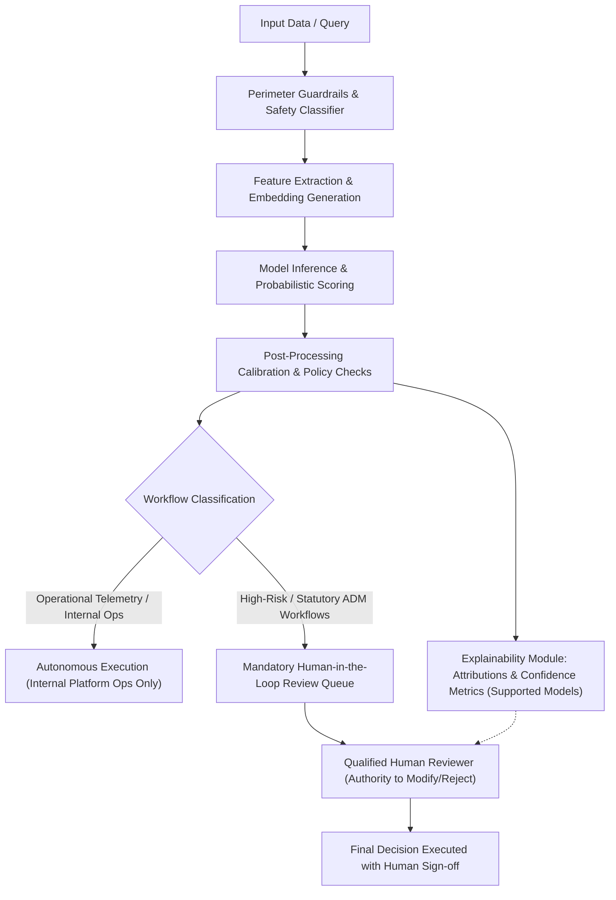

# Automated Decision-Making (ADM) Notice

**Document Reference:** AUC-AIG-ADM-001  
**Version:** 2.1  
**Effective Date:** `[Insert Effective Date]`  
**Last Updated:** October 22, 2026  
**Classification:** Public / Transparency  
**Regulatory Baselines:** GDPR Articles 13(2)(f), 14(2)(g), 22 | UK GDPR & Data Use and Access Act 2025 (DUAA) | California CPRA § 1798.185(a)(16) & ADMT Regulations | EU AI Act (Regulation (EU) 2024/1689, Article 13 & 14)

---

## 1. Purpose and Overview

This Automated Decision-Making Notice ("**ADM Notice**") provides clear, transparent information regarding how **Auctoric, LLC** ("**Auctoric**") utilizes, facilitates, and governs Automated Decision-Making (ADM), profiling, and autonomous agent workflows.

Under global data protection laws (including the EU/UK General Data Protection Regulation and California Consumer Privacy Act/CPRA), individuals have specific rights regarding decisions made solely by automated processing that produce legal or similarly significant effects. This document explains the underlying logic, operational boundaries, and rights of affected individuals.

---

## 2. When Does Auctoric Use or Support ADM?

### 2.1 Direct Auctoric Platform Operations
In its direct operations, Auctoric applies automated processing solely for platform operational integrity and cybersecurity:
* **Real-Time Threat & Abuse Detection:** Automated classifiers analyze API telemetry, request frequencies, and prompt payloads to detect denial-of-service attempts, credential stuffing, prompt injection, and Acceptable Use Policy violations.
* **Service Capacity & Load Shedding:** Autonomous rate-limiting heuristics dynamically allocate compute clusters based on subscription quotas and cluster health.

> [!NOTE]
> None of Auctoric's direct platform operations produce legal effects or similarly significant effects on consumers or employees without human review.

### 2.2 Customer Applications Built on Auctoric (Deployer Scenarios)
Enterprise customers ("**Deployers**") utilize the Auctoric platform to orchestrate LLM workflows, autonomous agents, and decision engines that may process data regarding third-party consumers, applicants, or employees (e.g., customer service triage, claims assistance, administrative routing).

In these deployment scenarios:
* **Customer is the Data Controller** determining the purpose and means of ADM.
* **Auctoric is the Technology Provider / Data Processor**, furnishing the governed orchestration engine, safety classifiers, and audit trail.

---

## 3. Algorithmic Logic and Explainability Architecture

When Auctoric’s decision engines evaluate inputs, the processing follows a verifiable, multi-stage pipeline:

### 3.1 Explainability Metrics and Technical Boundaries
Where supported by the underlying model architecture (e.g., open-weights enclaves and supported fine-tuned endpoints), Auctoric provides deployers with explainability interfaces:
* **Feature Attribution:** Generates feature attribution scores highlighting which specific input tokens or variables contributed most heavily to the output score.
* **Counterfactual Explanations:** Explains what specific variables would need to adjust for the model to produce an alternative classification.
* **Confidence Indicators:** Numerical confidence metrics accompanying classifications to assist human reviewers.
* *Architectural Limitation:* Customer acknowledges that third-party proprietary black-box APIs (e.g., external frontier models) do not expose gradient-level feature attribution; in such instances, Auctoric supplies prompt-context logging and natural-language rationale summaries.

---

## 4. Human Oversight Requirements (Human-in-the-Loop)

Under Auctoric’s [ISO 42001 & EU AI Act Governance Policy](iso-42001-eu-ai-act-policy.md), any automated workflow classified as **High-Risk** (e.g., employment screening, financial credit pre-qualification, essential public services) must be configured with **Human-in-the-Loop (HITL)** controls:

1. **Mandatory Human Approval:** Decisions producing legal effects cannot be finalized without explicit sign-off from an authorized human reviewer.
2. **Override Authority:** Reviewers possess full administrative authority to modify, reject, or reverse any model-suggested outcome.
3. **Reviewer Competence:** Personnel overseeing ADM must be trained to recognize automation bias, algorithmic drift, and system hallucinations.

---

## 5. Individual Data Subject Rights by Jurisdiction

Depending on your jurisdiction, you possess specific legal rights regarding automated processing:

### 5.1 European Union (GDPR Article 22)
* **Right Not to Be Subject to Solely Automated Decisions:** Individuals have the right not to be subject to a decision based solely on automated processing producing legal effects, subject to statutory exceptions (Art. 22(2)).
* **Right to Human Intervention:** Right to obtain human intervention, express one's point of view, and contest the decision.

### 5.2 United Kingdom (UK GDPR & DUAA 2025)
* Governed by retained UK GDPR provisions as amended by the Data Use and Access Act 2025, providing individuals with rights to safeguards, human review, and meaningful transparency regarding automated determinations.

### 5.3 California (CPRA & ADMT Regulations)
* Under California Automated Decisionmaking Technology regulations, consumers have the right to receive pre-use notices detailing the purpose of automated profiling, the logic involved, and the right to opt-out of automated processing for covered employment, educational, or significant financial/housing determinations.

---

## 6. How to Exercise Your Rights

### 6.1 Direct Platform Users (Account Holders)
To request an explanation or dispute an automated account action (e.g., security rate throttle):
* **Online Portal:** `[https://auctoric.ai/privacy/adm-review]`
* **Email:** `[adm-review@auctoric.ai]` or `[privacy@auctoric.ai]`

### 6.2 End-Users of Customer Applications
If your application or interaction was with an enterprise customer utilizing Auctoric's platform (e.g., an employer, insurer, or financial institution), you should submit your request directly to that organization (the Data Controller). Upon receipt of verified controller instructions, Auctoric will provide all requisite audit telemetry and algorithmic explanations to facilitate your request.

---

## 7. Contact Details

For inquiries regarding this ADM Notice or our algorithmic governance practices:
* **Chief AI Governance Officer:** `[caigo@auctoric.ai]`
* **Data Protection Officer:** `[dpo@auctoric.ai]`
* **Mailing Address:** `[Auctoric, LLC, 100 Enterprise Way, Suite 400, San Francisco, CA 94105]`
