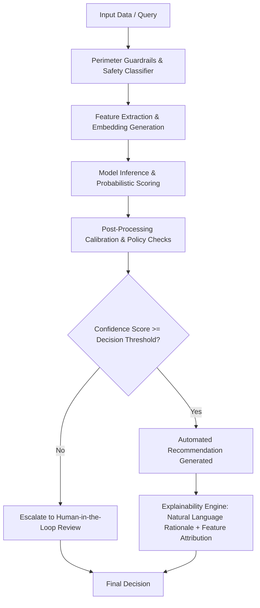

# Automated Decision-Making (ADM) Notice

**Document Reference:** AUC-AIG-ADM-001  
**Version:** 2.0  
**Effective Date:** `[Insert Effective Date]`  
**Last Updated:** October 22, 2026  
**Classification:** Public / Transparency  
**Regulatory References:** GDPR Articles 13(2)(f), 14(2)(g), 22 | UK GDPR | California CPRA § 1798.185(a)(16) | EU AI Act (Regulation (EU) 2024/1689, Article 13 & 14) | FTC Section 5 Guidance

---

## 1. Purpose and Overview

This Automated Decision-Making Notice ("**ADM Notice**") provides clear, transparent information regarding how **[Auctoric, Inc.]** ("**Auctoric**") utilizes, facilitates, and governs Automated Decision-Making (ADM), profiling, and autonomous agent workflows.

Under global data protection laws (including the EU/UK General Data Protection Regulation and California Consumer Privacy Act/CPRA), individuals have specific rights regarding decisions made solely by automated processing that produce legal or similarly significant effects. This document explains the underlying logic, significance, potential consequences, and rights of affected individuals.

---

## 2. When Does Auctoric Use or Support ADM?

### 2.1 Direct Auctoric Platform Operations
In its direct operations, Auctoric applies automated processing solely for operational integrity and cybersecurity:
* **Real-Time Threat & Abuse Detection:** Automated classifiers analyze API telemetry, request frequencies, and prompt payloads to detect denial-of-service attempts, credential stuffing, prompt injection, and Acceptable Use Policy violations.
* **Service Capacity & Load Shedding:** Autonomous rate-limiting heuristics dynamically allocate GPU compute clusters based on subscription quotas and cluster health.

> [!NOTE]
> None of Auctoric's direct platform operations produce legal effects or similarly significant effects on consumers or employees without human review.

### 2.2 Customer Applications Built on Auctoric (Deployer Scenarios)
Enterprise customers ("**Deployers**") utilize the Auctoric platform to orchestrate LLM workflows, autonomous agents, and decision engines that may process data regarding third-party consumers, applicants, or employees (e.g., resume screening, credit pre-qualification, claims triaging).

In these deployment scenarios:
* **Customer is the Data Controller** determining the purpose and means of ADM.
* **Auctoric is the Technology Provider / Data Processor**, furnishing the governed orchestration engine, safety classifiers, and audit trail.

---

## 3. Algorithmic Logic and Explainability Architecture

When Auctoric’s decision engines evaluate inputs, the processing follows a verifiable, multi-stage pipeline:

### 3.1 Explainability Metrics
Auctoric provides deployers with explainability interfaces:
* **Feature Importance / Attribution:** Generates SHAP (Shapley Additive Explanations) and Integrated Gradients scores highlighting which specific input features contributed most heavily to the output.
* **Counterfactual Explanations:** Explains what specific variables would need to change for the automated system to arrive at a different outcome (e.g., *"If debt-to-income ratio were reduced below 35%, confidence score would increase by 22%"*).
* **Confidence Intervals:** Explicit numerical probabilities accompanying every classification or score.

---

## 4. Human Oversight Requirements (Human-in-the-Loop)

Under Auctoric’s [ISO 42001 & EU AI Act Governance Policy](iso-42001-eu-ai-act-policy.md), any automated workflow classified as **High-Risk** (e.g., employment screening, healthcare triage, credit underwriting, criminal justice, essential public services) must be configured with **Human-in-the-Loop (HITL)** controls:

1. **Mandatory Human Approval:** Decisions producing legal effects cannot be finalized without explicit sign-off from an authorized human reviewer.
2. **Override Authority:** Reviewers possess full administrative authority to modify, reject, or reverse any model-suggested outcome.
3. **Training & Competence:** Personnel overseeing ADM must be trained to recognize automation bias, algorithmic drift, and system hallucinations.

---

## 5. Individual Data Subject Rights

If your personal data is subject to automated decision-making facilitated by the Auctoric platform, you have the following legal rights under GDPR Article 22, CPRA, and related statutes:

### 5.1 Right to Be Informed
You have the right to receive clear, meaningful information about the logic involved, the criteria utilized, and the significance and envisaged consequences of the processing.

### 5.2 Right to Obtain Human Intervention
You have the right not to be subject to a decision based solely on automated processing. You may request that a qualified human reviewer examine your file and make the determination.

### 5.3 Right to Express Your Point of View & Contest the Decision
You have the right to provide additional context, dispute the accuracy of data fed into the automated model, and formally contest any adverse outcome.

### 5.4 Right to Opt-Out (California Residents - CPRA)
Under the California Consumer Privacy Act (CPRA), California residents have the right to opt-out of businesses' use of Automated Decisionmaking Technology for profiling, employment decisions, or significant financial/housing determinations.

---

## 6. How to Exercise Your Rights

### 6.1 If Auctoric is the Direct Controller (Account Holders & Platform Users)
To request an explanation, dispute an automated account action (e.g., security suspension), or exercise privacy rights:
* **Online Portal:** `[https://auctoric.ai/privacy/adm-review]`
* **Email:** `[adm-review@auctoric.ai]` or `[privacy@auctoric.ai]`

### 6.2 If Auctoric is the Technology Provider (End-Users of Customer Applications)
If your application or interaction was with an enterprise customer utilizing Auctoric's platform (e.g., a bank, healthcare network, or employer), you should submit your request directly to that organization (the Data Controller). Upon receipt of verified controller instructions, Auctoric will provide all requisite audit telemetry and algorithmic explanations to facilitate your request.

---

## 7. Contact Details

For inquiries regarding this ADM Notice or our algorithmic governance practices:
* **Chief AI Governance Officer:** `[caigo@auctoric.ai]`
* **Data Protection Officer:** `[dpo@auctoric.ai]`
* **Mailing Address:** `[Auctoric, Inc., 100 Enterprise Way, Suite 400, San Francisco, CA 94105]`
