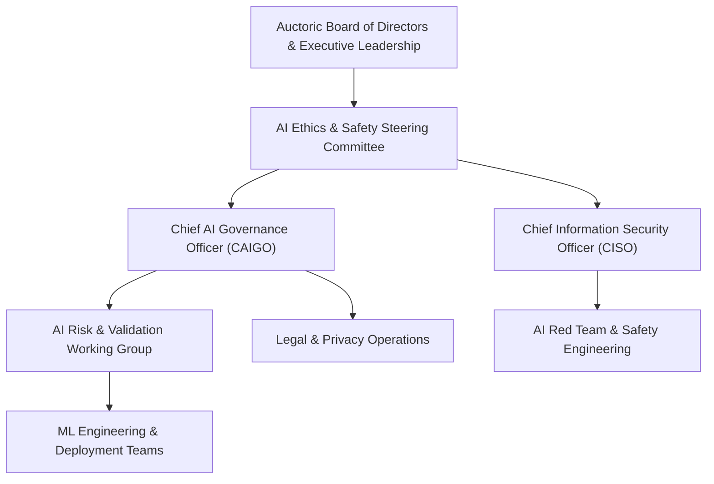

# ISO 42001 & EU AI Act Governance Policy

**Document Reference:** AUC-AIG-POL-001  
**Version:** 2.0  
**Effective Date:** `[Insert Effective Date]`  
**Last Updated:** October 22, 2026  
**Classification:** Corporate Governance / Public Trust  
**Standards Alignment:** ISO/IEC 42001:2023 (AIMS) | Regulation (EU) 2024/1689 (EU AI Act) | NIST AI RMF 1.0

---

## 1. Purpose and Executive Summary

**[Auctoric, Inc.]** ("**Auctoric**") is committed to engineering, deploying, and governing trustworthy, robust, and ethical Artificial Intelligence systems. This Policy establishes Auctoric’s **Artificial Intelligence Management System (AIMS)** pursuant to **ISO/IEC 42001:2023** and operationalizes mandatory compliance obligations under the **European Union Artificial Intelligence Act (EU AI Act, Regulation (EU) 2024/1689)**.

As a provider of enterprise Governed AI infrastructure, Auctoric establishes verifiable controls spanning model risk classification, human oversight, transparency, data provenance, robustness, and post-market monitoring across the entire AI system lifecycle.

---

## 2. Governance Structure & Roles

### 2.1 AI Ethics & Safety Steering Committee
The Steering Committee meets monthly to review high-risk use cases, systemic risk evaluations, algorithmic bias audits, and regulatory alignment across jurisdictions.

### 2.2 Key Roles & Responsibilities
* **Chief AI Governance Officer (CAIGO):** Accountable for overall AIMS compliance, AI conformity assessments, and regulatory liaison with the European AI Office and national market surveillance authorities.
* **Chief Information Security Officer (CISO):** Directs adversarial red-teaming, prompt injection mitigations, and technical security controls (ISO 27001 / OWASP LLM Top 10).
* **AI Safety Engineers:** Validate guardrail performance, toxicity benchmarks, data lineage, and model card completeness.
* **Customer Deployers:** Accountable for deployer obligations under Article 26 of the EU AI Act when integrating Auctoric APIs into downstream applications.

---

## 3. EU AI Act Classification and Risk Tiering

Auctoric enforces a formal risk triage process prior to developing or offering any AI model, tool, or autonomous agent capability:

| Tier | EU AI Act Classification | Auctoric Platform Implementation | Permitted Deployment Status |
| :--- | :--- | :--- | :--- |
| **Tier 1: Prohibited** (Art. 5) | Subliminal manipulation, social scoring, biometric categorization for sensitive attributes, untargeted facial scraping, workplace emotion inference. | Hardcoded runtime architectural guardrails; strictly forbidden via Acceptable Use Policy. | **STRICTLY PROHIBITED** |
| **Tier 2: High-Risk** (Art. 6 & Annex III) | Critical infrastructure, education admissions, employment/recruitment decisions, essential public services, law enforcement assistance, credit scoring. | Subject to mandatory Conformity Assessment, Continuous Risk Management (Art. 9), Data Governance (Art. 10), Technical Documentation (Art. 11), Automatic Logging (Art. 12), and Human Oversight (Art. 14). | **PERMITTED WITH AUDITED CONTROLS & DUAL AUTHORIZATION** |
| **Tier 3: Specific Transparency / GPAI** (Art. 50 & 51) | General-Purpose AI (GPAI) models with systemic risk, conversational AI, deepfakes, synthetic text/media. | Automated watermarking (C2PA standard), synthetic content disclosure banners, transparency model cards, copyright compliance summaries. | **PERMITTED WITH MANDATORY DISCLOSURES** |
| **Tier 4: Minimal Risk** (Art. 69) | AI-enabled search indexing, automated code completion, spam filters, administrative optimization. | Voluntary adherence to Auctoric Responsible AI Principles and ISO 42001 continuous improvement. | **PERMITTED UNDER STANDARD POLICY** |

---

## 4. ISO/IEC 42001 AI Management System (AIMS) Controls

Auctoric implements the core control domains established by ISO/IEC 42001:

### 4.1 AI Policy and Context (Clause 4 & 5)
Auctoric reviews internal AI objectives, societal impact assessments, and stakeholder expectations on a semi-annual cadence.

### 4.2 AI Risk Assessment & Treatment (Clause 6 & Annex A.5)
* **Risk Identification:** Evaluation of algorithmic bias, model drift, data poisoning, prompt injection (OWASP LLM01), sensitive data disclosure (LLM06), and hallucinations.
* **Treatment Protocols:** Implementation of real-time input/output guardrails, retrieval-augmented grounding (RAG), and deterministic confidence thresholds.

### 4.3 Data Governance for AI (Annex A.6)
* **Data Lineage:** Complete tracking of training datasets, fine-tuning corpuses, and synthetic benchmark sources using cryptographically signed manifests.
* **Bias & Fairness Mitigation:** Pre-deployment statistical parity, disparate impact analysis, and demographic representation reviews across datasets.
* **Data Minimization:** Exclusion of unnecessary PII from training pipelines using automated masking and differential privacy.

### 4.4 Model Development, Verification & Validation (Annex A.7)
* Models undergo structured offline benchmarking across standardized evaluations (MMLU, HELM, TrustLLM) prior to promotion to staging.
* Independent adversarial red-teaming evaluating jailbreaks, prompt extraction, and multi-turn manipulation.

### 4.5 Post-Market Monitoring & Continuous Learning (Annex A.8)
* Telemetry monitoring model drift, latency, token throughput, and safety filter triggering rates.
* Regular calibration checks to ensure consistency and reliability over extended production cycles.

---

## 5. Technical Documentation & Conformity (EU AI Act Articles 11 & 12)

For all High-Risk AI configurations, Auctoric maintains dynamic Technical Documentation in an auditable repository including:
1. System description, intended purpose, and authorized deployer profiles;
2. Algorithmic architecture specifications, model parameters, and training methodologies;
3. Dataset descriptions (provenance, curation methodology, labeling validation, and bias mitigation measures);
4. Risk management file detailing identified hazards, residual risks, and mitigation verifications;
5. Audit logs automatically capturing inference timestamps, user session tokens, model versions, prompt hashes, and guardrail trigger flags, retained for a minimum of twelve (12) months.

---

## 6. Transparency and User Disclosure (EU AI Act Article 50)

Auctoric provides automated transparency mechanisms ensuring that end-users are clearly informed when interacting with an AI system:
* **Interactive Agents:** System prompts explicitly announce the artificial nature of conversational interfaces (e.g., *"I am an AI assistant hosted on the Auctoric platform"*).
* **Synthetic Media & Text Watermarking:** Machine-generated assets carry cryptographic C2PA provenance metadata and invisible watermarking verifying Auctoric origin.
* **Public Model Cards:** Published datasheets covering model architecture, limitations, evaluation metrics, and intended operational domains.

---

## 7. Serious Incident Reporting (EU AI Act Article 73)

### 7.1 Definition of Serious Incident
Any incident involving an Auctoric AI system that directly or indirectly leads to:
1. Death or serious harm to a person’s health;
2. Serious and irreversible disruption of critical infrastructure;
3. Breach of obligations under European Union law intended to protect fundamental rights;
4. Serious property or environmental damage.

### 7.2 Reporting Timelines
Auctoric shall notify the relevant national market surveillance authorities and the EU AI Office within **fifteen (15) calendar days** of becoming aware of a serious incident, and within **forty-eight (48) hours** in the event of widespread, critical public harm.

---

## 8. Compliance Audits and Enforcement

* **Internal Audits:** Conducted biannually by the Internal Audit team in coordination with the CAIGO.
* **Third-Party Conformity Assessment:** Conducted annually by accredited EU Notified Bodies and ISO 42001 certification auditors.
* **Enforcement:** Non-compliance with this policy by Auctoric personnel is grounds for disciplinary action up to and including termination of employment.

---

## 9. Inquiries & Regulatory Contact

* **Chief AI Governance Officer:** `[caigo@auctoric.ai]`
* **AI Ethics & Safety Office:** `[ai-ethics@auctoric.ai]`
* **Official Postal Address:** `[Auctoric, Inc., 100 Enterprise Way, Suite 400, San Francisco, CA 94105]`
