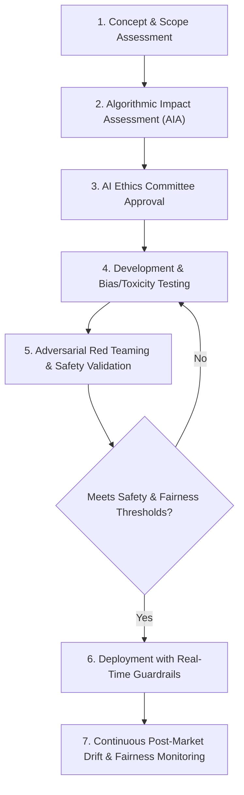

# Responsible AI & Ethics Statement

**Document Reference:** AUC-AIG-ETH-001  
**Version:** 2.1  
**Effective Date:** `[Insert Effective Date]`  
**Last Updated:** October 22, 2026  
**Classification:** Public / Ethics & Trust  
**International Alignment:** OECD AI Principles | NIST AI RMF 1.0 | UNESCO AI Ethics Recommendation | EU AI Act (Art. 10, 13, 14)

---

## 1. Executive Commitment

At **[Auctoric, Inc.]** ("**Auctoric**"), our mission is to build intelligent, autonomous, and governed AI systems that augment human capability, safeguard fundamental human rights, and operate with verifiable integrity.

We recognize that Artificial Intelligence brings unprecedented transformative potential alongside genuine socio-technical risks—including algorithmic bias, deepfake proliferation, informational manipulation, privacy erosion, and opaque decision-making. This Responsible AI & Ethics Statement defines the foundational ethical tenets and operational standards that guide every algorithm we train, every API we deploy, and every enterprise partnership we forge.

---

## 2. Our Core AI Ethics Principles

### Principle 1: Human Agency and Oversight (Human-in-the-Loop)
AI systems must empower human agency rather than undermine human autonomy.
* Auctoric designs systems with configurable levels of human oversight: Human-in-the-Loop (HITL), Human-on-the-Loop (HOTL), and Human-in-Command (HIC).
* For high-consequence operations (e.g., judicial, healthcare, credit determinations, public benefit allocation), our platform enforces mandatory human review before autonomous actions are executed.
* Users always possess the ability to override, interrupt, or shut down agentic workflows.

### Principle 2: Fairness, Non-Discrimination, and Inclusivity
AI systems must be designed to avoid perpetuating historical prejudices or amplifying unfair bias.
* We actively evaluate training and benchmarking datasets for demographic disparity across protected classes (race, gender, age, religion, disability, socioeconomic status).
* We implement pre-processing data balancing, in-processing adversarial debiasing, and post-processing calibration algorithms to minimize disparate impact.
* We conduct recurring demographic parity and equalized odds testing across model releases.

### Principle 3: Transparency, Explainability, and Contestability
Individuals affected by AI systems are entitled to understand when they are interacting with AI and the rationale behind automated outputs.
* **Radical Transparency:** We maintain standardized Model Cards and System Datasheets documenting model architectures, data sources, known limitations, and performance boundaries.
* **Explainability:** We provide interpretability tooling—including feature attribution maps, attention visualizations, and natural-language rationale summaries—to explain complex model predictions.
* **Contestability:** We empower individuals with accessible avenues to challenge AI-driven outcomes and seek human reconsideration.

### Principle 4: Technical Robustness, Safety, and Security
AI systems must operate reliably, predictably, and safely under normal and adversarial conditions.
* We architect multi-layered defense-in-depth against prompt injection, jailbreaking, data poisoning, and model extraction.
* We conduct continuous automated adversarial stress testing and engage independent external red teams.
* Systems incorporate deterministic fail-safe modes and fallback heuristics when uncertainty metrics exceed acceptable safety margins.

### Principle 5: Privacy, Data Sovereignty, and Intellectual Property
AI development must honor individual privacy rights and respect proprietary creative work.
* We adhere to privacy-by-design and data minimization principles throughout the machine learning lifecycle.
* **We do not train public models on customer inputs, prompts, or sensitive enterprise data.**
* We respect copyright and intellectual property rights in data acquisition, curating training sources responsibly with explicit licensing or public domain verification.

### Principle 6: Environmental Sustainability & Compute Efficiency
Responsible AI requires stewardship of planetary resources.
* We prioritize energy-efficient model architectures, parameter-efficient fine-tuning (LoRA, QLoRA), distillation, and quantized inference (FP8/INT4) to reduce carbon footprints.
* We host workloads in cloud data centers committed to 100% renewable energy and publish compute carbon intensity metrics.

---

## 3. Operationalizing Ethics: Governance in Practice

Ethics at Auctoric is not a theoretical manifesto—it is an enforced engineering discipline:

### 3.1 Algorithmic Impact Assessments (AIAs)
Before any novel model, autonomous tool, or high-risk capability enters production, product teams must complete an Algorithmic Impact Assessment evaluating:
* Societal and human rights implications;
* Potential failure modes and secondary unintended consequences;
* Vulnerability to adversarial weaponization.

### 3.2 The Auctoric AI Ethics Committee
Chaired by the Chief AI Governance Officer, this multidisciplinary committee comprises technical researchers, ethicists, legal counsel, and external civil society advisors. The Committee holds binding veto authority over any model release or partnership that compromises our ethical principles.

---

## 4. Red Lines: Applications We Refuse to Support

Auctoric draws an unequivocal line against technologies that violate fundamental rights. We will never develop, license, or facilitate:
1. Autonomous lethal weapon systems or kinetic warfare targeting algorithms;
2. Mass public surveillance, facial recognition sweeps, or social credit scoring regimes;
3. Systems engineered to deceive or manipulate vulnerable populations (children, elderly, cognitively impaired);
4. Deepfake generation intended to defraud, intimidate, or fabricate non-consensual sexual material.

---

## 5. Stakeholder Engagement and Reporting

We welcome external scrutiny and feedback from civil society, academic researchers, and affected communities:
* **Ethics Concerns:** `[ethics@auctoric.com]`
* **Algorithmic Bias Reports:** `[bias-report@auctoric.com]`
* **Public Transparency Hub:** `[https://auctoric.com/trust/ethics]`
