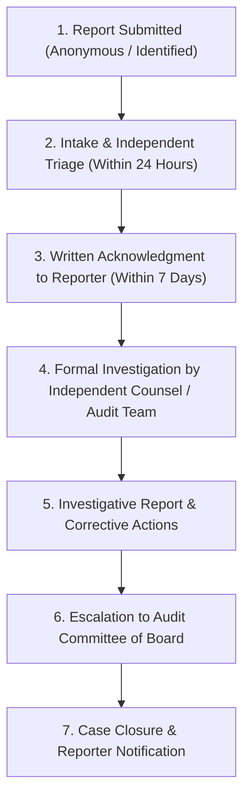

# Whistleblower & Non-Retaliation Policy

**Document Reference:** AUC-GOV-WBP-001  
**Version:** 2.5  
**Effective Date:** `[Insert Effective Date]`  
**Last Updated:** October 22, 2026  
**Classification:** Public / Corporate Governance  
**Statutory Alignment:** Sarbanes-Oxley Act § 806 | Dodd-Frank Act § 922 | Directive (EU) 2019/1937 (EU Whistleblower Directive) | UK Public Interest Disclosure Act 1998

---

## 1. Purpose and Philosophy

**Auctoric, LLC** ("**Auctoric**") is committed to upholding the highest standards of legal compliance, ethical conduct, financial integrity, and algorithmic safety. We recognize that employees, contractors, and partners are frequently the first to identify systemic risks, fraud, safety bypasses, or unlawful behavior.

This Whistleblower & Non-Retaliation Policy ("**Policy**") establishes safe, confidential, and anonymous mechanisms for reporting concerns without fear of adverse employment consequences, retaliation, or professional detriment.

---

## 2. Scope of Reportable Conduct

This Policy encourages reporting of any suspected or confirmed misconduct, including but not limited to:

1. **Financial Malpractice & Accounting Fraud:** Falsification of financial statements, misrepresentation of revenues, tax evasion, internal control circumvention, or auditor interference.
2. **AI Safety & Algorithmic Deception:** Falsifying model benchmark evaluations, intentionally concealing model hallucinations or safety filter bypasses, training public models on customer data in breach of contractual covenants, or violating EU AI Act prohibited practices.
3. **Bribery, Corruption & Antitrust:** Violations of the Foreign Corrupt Practices Act (FCPA), commercial kickbacks, bid-rigging, or illegal price-fixing arrangements.
4. **Data Privacy & Cybersecurity Violations:** Concealing data breaches, deliberate unauthorized exfiltration of customer information, or willful circumvention of SOC 2 / ISO 27001 controls.
5. **Harassment, Discrimination & Labor Abuses:** Severe workplace harassment, civil rights violations, or workplace safety hazards.

---

## 3. Reporting Channels & Confidentiality

Auctoric provides multiple independent reporting channels. Individuals may choose to identify themselves or remain completely anonymous:

### 3.1 Independent Third-Party Whistleblower Hotline
Operated 24 hours a day, 365 days a year by an independent ethics reporting provider (EthicsPoint / NAVEX):
* **Web Portal:** `[https://auctoric.ethicspoint.com]`
* **Toll-Free Phone (US/Canada):** `[+1 (800) 555-ETHX]`
* **International Dial-In Numbers:** Available via web portal for EU/UK and worldwide locations.

### 3.2 Direct Internal Escalation
* **Head of Compliance & Legal Counsel:** `[legal-compliance@auctoric.ai]`
* **Chair of the Audit Committee (Board of Directors):** `[audit-committee-chair@auctoric.ai]`
* **Mailing Address:** `[Auctoric, LLC, Attn: Audit Committee Chair, 100 Enterprise Way, Suite 400, San Francisco, CA 94105]` (Marked: *"CONFIDENTIAL & PRIVILEGED - TO BE OPENED ONLY BY AUDIT COMMITTEE"*)

---

## 4. Protection Against Retaliation (Strict Zero Tolerance)

Auctoric maintains an **absolute zero-tolerance policy against retaliation**:

* **Protected Activities:** No person who in good faith reports a concern, assists another person in reporting, or participates in an investigation shall suffer discharge, demotion, suspension, threat, harassment, or discrimination in terms of employment.
* **Legal Shield:** This protection applies regardless of whether the investigation ultimately substantiates the reported concern, provided the report was made with an honest, reasonable belief in its truth.
* **Sanctions for Retaliation:** Any employee, supervisor, officer, or director found to have engaged in retaliatory behavior will be subject to immediate disciplinary termination and personal civil/criminal liability under applicable federal and state whistleblower statutes.

---

## 5. Investigation and Resolution Process

### 5.1 Timelines & Due Process
1. **Receipt Acknowledgment:** The reporter receives a tracking key and written acknowledgment within seven (7) calendar days of submission.
2. **Independent Investigation:** Reports involving senior executives or accounting practices are investigated directly under the oversight of the Audit Committee of the Board of Directors, with external legal counsel where appropriate.
3. **Resolution:** Reports are thoroughly investigated within sixty (60) days. Summary resolution updates are provided to the reporter via the secure portal tracking key.

---

## 6. Retention and Records

All records concerning whistleblower reports, investigative findings, and remediation actions are maintained securely by the Legal Department for a minimum of seven (7) years in encrypted, access-restricted storage.
