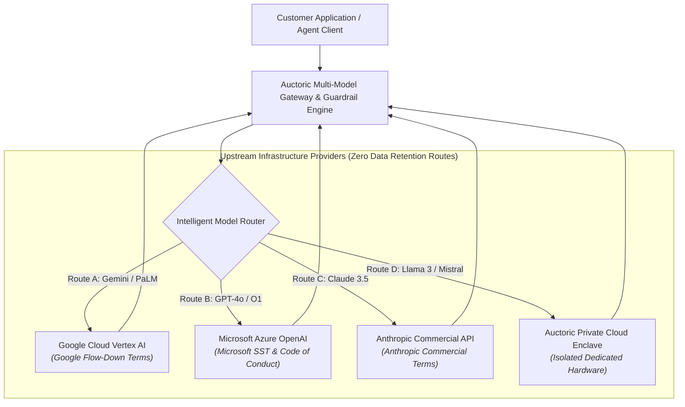

# AI Service-Specific Terms (SST) — Schedule 1

**Document Reference:** AUC-LEG-SST-001  
**Version:** 1.1  
**Effective Date:** `[Insert Effective Date]`  
**Last Updated:** October 22, 2026  
**Classification:** Public / Legal Schedule  
**Incorporated By:** [Master Services Agreement](master-services-agreement.md) | [Terms of Service](terms-of-service.md)  
**Harmonized Provider Standards:** Google Cloud Vertex AI Service-Specific Terms | Microsoft Azure OpenAI Terms | Anthropic Commercial Terms | OpenAI Business Terms

---

## 1. Structure, Applicability, and Order of Precedence

These AI Service-Specific Terms ("**SST**" or "**Schedule 1**") govern Customer’s access to and use of all artificial intelligence inference engines, autonomous agent execution runtimes, retrieval-augmented generation (RAG) vector pipelines, and fine-tuning endpoints provided via the **Auctoric Governed AI Platform** ("**Services**").

This Schedule supplements the [Master Services Agreement](master-services-agreement.md) ("**MSA**") or [Terms of Service](terms-of-service.md) ("**ToS**"). In the event of any conflict between the universal core terms of the MSA/ToS and this Schedule, this Schedule shall govern with respect to AI-specific functionality, model routing, and outputs.

---

## 2. Multi-Cloud & Foundation Model Architecture

Auctoric provides an enterprise multi-model routing gateway capable of orchestrating workloads across leading foundation model providers as well as Auctoric's private fine-tuned checkpoints:

---

## 3. Mandatory Universal Flow-Down Restrictions

To ensure operational stability across our hyperscaler infrastructure partnerships, Customer agrees to the following flow-down covenants derived from the most restrictive terms in our stack (including **Google Cloud Vertex AI Additional Terms**, **Microsoft Azure OpenAI Service Terms**, and **Anthropic Commercial Guidelines**):

### 3.1 Strict Prohibition on Competing Model Training & Distillation
Customer warrants, covenants, and agrees that **Outputs will NOT be used to train, retrain, bootstrap, calibrate, fine-tune, or distantly supervise any artificial intelligence, machine learning, or foundation models that compete directly or indirectly with Auctoric, Google Cloud, Microsoft Azure, or Anthropic**. 
* Customer may use Outputs to validate, evaluate, and test existing internal software systems.
* Synthesizing datasets from Outputs specifically to replicate, distill, or extract the model weights, latent capabilities, or reasoning architectures of underlying platform models is strictly prohibited and constitutes a material, non-curable breach of contract.

### 3.2 Competitive Benchmarking Restrictions
Customer shall not publicly disclose, publish, or disseminate the results of any competitive benchmarking, stress tests, comparative latency evaluations, or performance assessments of the Services or underlying foundation models without prior written mutual approval from Auctoric and the respective upstream model provider.

### 3.3 Pass-Through Upstream Abuse Suspension
Customer acknowledges that upstream hyperscalers operate automated network telemetry and threat intelligence systems. **If Google Cloud, Microsoft Azure, or Anthropic issues an abuse notification, safety strike, or rate throttle directly resulting from Customer’s traffic, prompts, or API calls, Auctoric reserves the contractual right to immediately suspend or restrict Customer's access to the affected model endpoint** without prior notice, until the underlying security or policy violation is remedied. Auctoric will provide notice and restoration criteria as soon as practicable.

---

## 4. High-Consequence Sector Restrictions

### 4.1 Healthcare and Clinical Decision-Making Absolute Prohibition
CUSTOMER EXPRESSLY ACKNOWLEDGES THAT THE SERVICES ARE NOT DESIGNED, TESTED, OR CERTIFIED AS MEDICAL DEVICES UNDER THE U.S. FDA, EU MEDICAL DEVICE REGULATION (MDR 2017/745), OR EQUIVALENT INTERNATIONAL REGULATORY REGIMES. 
* **Clinical Purpose Ban:** Customer shall not utilize the Services, directly or indirectly, for automated medical diagnosis, clinical triage, patient-specific treatment planning, emergency medical recommendations, or prescription management. Neither the presence of licensed professional supervision, nor a customer’s regulated healthcare status, nor the execution of a HIPAA Business Associate Agreement authorizes a clinical use prohibited by an underlying foundation model provider (including Google Cloud Vertex AI).
* **Administrative Uses Only:** Non-clinical healthcare administrative operations (e.g., medical scheduling, administrative intake drafting, billing coding assistance) are permitted where verified by administrative staff prior to finalization.

### 4.2 Critical Infrastructure & Kinetic Systems
The Services are not fault-tolerant and are not engineered for use in hazardous, fail-safe environments requiring fail-safe performance. Customer shall not integrate Auctoric into nuclear facility operations, air traffic control systems, real-time public water/electrical utility grids, life support systems, or autonomous weapons platforms.

### 4.3 High-Stakes Legal, Judicial, and Financial Profiling
Under Article 14 of the EU AI Act and GDPR Article 22, any use of the platform to generate evaluations affecting individual legal status, creditworthiness, loan qualification, employment screening, or housing access must maintain **mandatory Human-in-the-Loop (HITL)** controls with verifiable human override authority.

### 4.4 Downstream Application Audience & Minors
Customer warrants and covenants that it will not deploy Customer Applications powered by the Services to target, market to, or be intentionally accessed by individuals under eighteen (18) years of age, complying strictly with upstream foundation model provider restrictions.

---

## 5. Autonomous Agents and Tool Execution Governance

When Customer configures autonomous agents capable of dynamic multi-turn execution, web browsing, code execution, or database function calling:

### 5.1 Tool Authorization and Scoping
* Customer is exclusively responsible for provisioning and scoping API credentials, OAuth tokens, and database permissions supplied to autonomous agents.
* Customer warrants that agents will operate under the principle of least privilege (e.g., read-only tokens for querying data, dual-authorization gates for write/delete actions).

### 5.2 Recursive Loops and Rate Ceilings
Auctoric enforces deterministic runaway execution limits (maximum recursion depth, maximum token expenditure per thread, execution timeouts) to protect customer billing and platform stability. Customer shall not configure autonomous agents to bypass execution loop throttles.

### 5.3 Responsibility for Agentic Tool Actions
Customer acknowledges that autonomous agents make probabilistic decisions regarding tool selection. Customer is responsible for its configured permissions, supplied credentials, authorized instructions, and approval decisions. This allocation does not relieve Auctoric of its obligations concerning platform-operated isolation, execution limits, or security controls.

---

## 6. Retrieval-Augmented Generation (RAG) & Vector Boundaries

1. **Cryptographic Tenant Segregation:** Customer vector indexes, semantic embeddings, and chunked context files are logically partitioned and encrypted using AES-256 with tenant-scoped encryption keys.
2. **Access Token Verification:** The platform verifies authorization headers on every vector similarity query; no cross-tenant query execution is technically permitted.
3. **Data Ingestion Representations:** Customer represents and warrants that it possesses all requisite licenses, authorizations, and consents to ingest external documents, databases, and proprietary corpuses into the Auctoric Knowledge Engine.

---

## 7. Model Non-Deterministic Output Disclaimer

CUSTOMER ACKNOWLEDGES THAT GENERATIVE AI SYSTEMS EMPLOY PROBABILISTIC ALGORITHMS AND LARGE LANGUAGE REASONING CHAINS THAT CAN PRODUCE VARIANT, INCOMPLETE, OR FACTUALLY INCORRECT OUTPUTS ("HALLUCINATIONS") EVEN WHEN PRESENTED WITH IDENTICAL INPUTS. EXCEPT FOR THE EXPRESS COMMITMENTS IN THE [CUSTOMER COPYRIGHT & IP PROTECTION ADDENDUM](customer-copyright-ip-protection-addendum.md), AUCTORIC DISCLAIMS ANY WARRANTY THAT OUTPUTS WILL BE DETERMINISTIC, FACTUAL, OR UNBIASED. CUSTOMER ASSUMES RESPONSIBILITY FOR INDEPENDENTLY VALIDATING ALL OUTPUTS BEFORE PRODUCTION CONSUMPTION.

---

## 8. Provider-Specific Flow-Down Appendices

When Customer’s requests are routed to specific underlying models, the following terms apply to that specific transaction:

* **Google Cloud Vertex AI (Gemini / PaLM):** Workloads are subject to the [Google Cloud Generative AI Prohibited Use Policy](https://policies.google.com/terms/generative-ai/use-policy) and [Vertex AI Service Terms](https://cloud.google.com/terms/service-terms).
* **Microsoft Azure OpenAI Service (GPT models):** Workloads are subject to the [Microsoft Code of Conduct for Azure OpenAI Service](https://learn.microsoft.com/en-us/legal/cognitive-services/openai/code-of-conduct).
* **Anthropic Commercial API (Claude models):** Workloads are subject to the [Anthropic Commercial Terms of Service](https://www.anthropic.com/legal/commercial-terms) and [Anthropic Usage Policy](https://www.anthropic.com/legal/aup).
