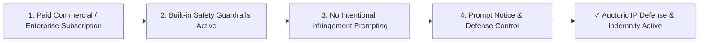

# Customer Copyright & IP Protection Addendum

**Document Reference:** AUC-LEG-CCC-001  
**Version:** 1.0  
**Effective Date:** `[Insert Effective Date]`  
**Last Updated:** October 22, 2026  
**Classification:** Legal / Intellectual Property Protection  
**Companion Documents:** [Master Services Agreement](master-services-agreement.md) | [AI Service-Specific Terms](ai-service-specific-terms.md) | [Acceptable Use Policy](acceptable-use-policy.md)  
**Industry Benchmarks:** Microsoft Customer Copyright Commitment (CCC) | Google Cloud Generative AI Indemnification | Anthropic Commercial IP Terms

---

## 1. Purpose and Executive Commitment

**Auctoric, LLC** ("**Auctoric**", a Florida limited liability company) is committed to standing behind our enterprise customers as they deploy generative Artificial Intelligence into production workflows. We recognize that intellectual property risks—particularly third-party claims alleging that generated AI outputs infringe copyrighted works—represent a significant operational consideration for enterprise General Counsels.

Under this Customer Copyright & IP Protection Addendum ("**Copyright Addendum**"), Auctoric extends a legally binding **Customer Copyright Commitment** to eligible enterprise customers executing a Master Services Agreement, establishing defense and indemnification protections against third-party copyright infringement claims arising from Customer's authorized use of the Auctoric Governed AI Platform.

---

## 2. Scope of Defense and Indemnification

### 2.1 Covered Claims
Subject to the terms and conditions of this Copyright Addendum and Section 8 and Section 9.3 of the Master Services Agreement, Auctoric shall:
1. **Defend** Customer, its Affiliates, and their respective directors, officers, and employees against any unaffiliated third-party legal claim, suit, action, or formal proceeding ("**Covered Claim**") alleging that an **Output** generated by and delivered to Customer through the Auctoric Platform infringes a valid third-party copyright; and
2. **Indemnify** Customer for any monetary damages, settlement amounts approved in writing by Auctoric, court-awarded costs, and reasonable external attorney fees finally awarded against Customer in connection with such Covered Claim.

### 2.2 Foundation Model Training Defense (Upstream Back-to-Back Protection)
Auctoric further defends Customer against third-party claims alleging that the pre-training, fine-tuning, or alignment datasets of Auctoric’s proprietary models or underlying foundational provider models (including Google Vertex AI, Azure OpenAI, and Anthropic Claude) infringed third-party copyright in creating the foundational model weights, to the extent such protection is covered under governing upstream provider terms.

---

## 3. Eligibility Criteria & Customer Safety Covenants

To qualify for the protections set forth in Section 2, Customer must satisfy and maintain the following operational and safety prerequisites (the "**Safety Covenants**"):

### 3.1 Executed Enterprise Agreement Status
Customer must be an active subscriber under an executed Enterprise Master Services Agreement (MSA) and Enterprise Order Form in good standing. This Copyright Addendum is an enterprise schedule and does not apply to self-service accounts governed solely by online Terms of Service, unpaid developer tiers, evaluation accounts, or free promotional trials.

### 3.2 Enforcement of Auctoric Guardrails
Customer must maintain active and enabled all standard Auctoric safety systems, output filters, and guardrails provided via the platform API or console, including:
1. Real-time copyright and verbatim text matching filters;
2. System-level content safety classifiers;
3. Domain-specific blocklists and PII/PCI redactors.

Customer shall not disable, circumvent, tamper with, or prompt-engineer around these safety boundaries.

### 3.3 No Intentional or Bad-Faith Prompts
Customer must not have submitted Inputs (prompts, context files, vector chunks, or reference images) with the deliberate intent to evoke, duplicate, or reproduce an infringing copy of a known copyrighted work, third-party proprietary trade secret, or protected intellectual property.

*Examples of Disqualifying Prompts:*
* *"Reproduce the exact source code of the proprietary Linux kernel module XYZ."*
* *"Write Chapter 1 of Harry Potter and the Sorcerer's Stone verbatim."*
* Submitting third-party copyrighted datasets into RAG vector indexes without appropriate intellectual property licenses.

---

## 4. Exclusions and Carve-Outs

Auctoric will have no obligation, defense duty, or liability under this Copyright Addendum for any Covered Claim arising from:
1. **Customer-Provided Content:** Claims alleging that Customer’s own Inputs, training corpuses, or customer-provided vector embeddings infringe third-party rights;
2. **Modified Outputs:** Any modification, translation, derivative work, or post-processing of Outputs performed by Customer or a third party not authorized by Auctoric;
3. **Combination with Third-Party Software:** Use of Outputs in combination with non-Auctoric software, hardware, or datasets where the infringement would not have occurred but for such combination;
4. **Continuation After Notice:** Customer’s continued public distribution or commercial exploitation of an Output after Auctoric has notified Customer to discontinue use due to a potential infringement hazard;
5. **Trademark / Commercial Misappropriation:** Customer’s use of Outputs in a manner intended to pass off goods or services as those of a competitor, engage in false advertising, or violate right-of-publicity statutes.

---

## 5. Indemnification Procedures & Tender of Defense

To invoke protection under this Copyright Addendum, Customer must:
1. **Prompt Written Notice:** Notify Auctoric in writing at `[legal@auctoric.ai]` within **fifteen (15) calendar days** of receiving notice of a Covered Claim or credible threat thereof (provided that failure to give prompt notice will relieve Auctoric of its obligations only to the extent such failure materially prejudices the defense);
2. **Sole Control:** Grant Auctoric sole control over the defense and settlement negotiations of the Covered Claim (provided Auctoric will not settle any claim that admits fault or imposes monetary or injunctive liability on Customer without Customer's prior written consent);
3. **Reasonable Assistance:** Provide reasonable cooperation, information, and assistance requested by Auctoric (at Auctoric’s expense) to defend the claim, including access to prompt logs, agent interaction traces, and output timestamps.

---

## 6. Auctoric Mitigation and Replacement Remedies

If an Output or platform model is held to infringe, or if Auctoric reasonably believes that an Output or model is likely to become the subject of an infringement claim, Auctoric may, at its sole discretion and expense:
1. **Procure Right:** Procure for Customer the legal right to continue using the Output or Service;
2. **Modify / Replace:** Replace or modify the Service, prompt routing, or Output so that it becomes non-infringing while providing substantially equivalent functionality; or
3. **Refund / Discontinue:** Terminate Customer's access to the affected Output or feature and refund any prepaid, unearned subscription fees paid by Customer for the impacted Service.

---

## 7. Relationship to Upstream Infrastructure Providers

Auctoric orchestrates foundational compute and model runtimes across cloud infrastructure providers, including Google Cloud (Vertex AI), Microsoft Azure (Azure OpenAI), and Anthropic. Auctoric will pursue applicable upstream defense or reimbursement rights where available under the governing provider agreement. Such availability does not expand the scope of this Addendum. Auctoric’s expressly assumed obligations remain subject to this Addendum and the applicable liability limit and are not represented as fully reimbursable by any upstream provider.

---

## 8. Order of Precedence & Liability Cap

In the event of any direct conflict between the terms of this Copyright Addendum and the Master Services Agreement, this Copyright Addendum shall control solely with respect to third-party copyright infringement claims involving AI Outputs. All monetary obligations, defense costs, approved settlements, and damages under this Copyright Addendum are expressly subject to the aggregate Super-Cap (2× Annual Contract Value) set forth in Section 9.3 of the Master Services Agreement.

---

**IN WITNESS WHEREOF**, this Customer Copyright & IP Protection Addendum is hereby incorporated into and made a binding schedule to the Master Services Agreement.

| **For Auctoric, LLC** | **For [Customer Legal Name]** |
| :--- | :--- |
| **Signature:** ___________________________ | **Signature:** ___________________________ |
| **Name:** `[Authorized Officer Name]` | **Name:** `[Authorized Officer Name]` |
| **Title:** `[Manager / Executive Officer]` | **Title:** `[Authorized Signatory Title]` |
| **Date:** `[Insert Date]` | **Date:** `[Insert Date]` |
