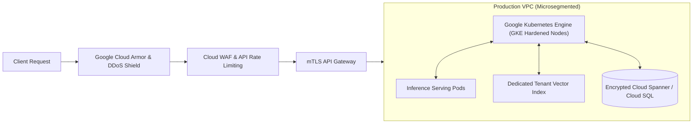

# Information Security Policy (ISP)

**Document Reference:** AUC-SEC-POL-001  
**Version:** 3.1  
**Effective Date:** `[Insert Effective Date]`  
**Last Updated:** October 22, 2026  
**Classification:** Internal / Auditor Access  
**Framework Alignment:** ISO/IEC 27001:2022 Control Alignment | SOC 2 Type II (Trust Services Criteria) | NIST CSF 2.0 | NIST SP 800-53 Rev. 5

---

## 1. Objective and Executive Commitment

This Information Security Policy ("**ISP**") defines the organizational framework, operational mandates, and technical controls established by **Auctoric, LLC** ("**Auctoric**") to preserve the **Confidentiality, Integrity, and Availability (CIA Triad)** of Auctoric information assets, customer data, and AI platform infrastructure.

Auctoric leadership is committed to maintaining an Information Security Management System (ISMS) engineered and managed to comply with **ISO/IEC 27001:2022** and **SOC 2 Type II (Trust Services Criteria)** standards.

---

## 2. Scope & Organizational Governance

### 2.1 Scope
This policy applies to all systems, networks, physical offices, cloud environments (Google Cloud Platform), employees, contractors, third-party vendors, and services operated by Auctoric globally.

### 2.2 Roles and Responsibilities
* **Board of Directors / Audit Committee:** Exercises executive oversight of the cybersecurity risk posture.
* **Chief Information Security Officer (CISO):** Directly accountable for the implementation, continuous monitoring, and enforcement of this ISP and ISMS controls.
* **Security Operations Center (SOC):** Operates 24/7/365 to triage alerts, investigate anomalous events, and execute incident containment.
* **All Personnel:** Mandatory obligation to uphold security practices, complete annual compliance training, and immediately report suspicious events.

---

## 3. Data Classification & Handling Matrix

All information created, stored, or processed at Auctoric is classified into four distinct tiers:

| Tier | Classification | Definition & Examples | Handling & Storage Controls |
| :--- | :--- | :--- | :--- |
| **Tier 1** | **Restricted / Critical** | Customer Content, API keys, private cryptographic keys, fine-tuned model weights, customer PHI/PII. | AES-256 encryption at rest; TLS 1.3 in transit; strict hardware-bound MFA; no local device caching; access logged to tamper-resistant storage. |
| **Tier 2** | **Confidential** | Source code, unreleased model architectures, financial ledgers, legal contracts, vulnerability scan reports. | Encrypted at rest; restricted by RBAC; requires NDA for external disclosure; stored in corporate managed cloud drives. |
| **Tier 3** | **Internal Use** | Internal roadmaps, general team discussions, employee handbooks, organizational charts. | Requires authenticated company credentials; not accessible to general public. |
| **Tier 4** | **Public** | Marketing collateral, published API documentation, approved blog posts, public model cards. | Integrity validated via CI/CD. |

---

## 4. Identity & Access Management (Zero Trust Architecture)

Auctoric enforces a **Zero Trust** security model: *"Never trust, always verify."*

### 4.1 Authentication & Multi-Factor Authentication (MFA)
* **Centralized Identity Provider (IdP):** All access to production, corporate applications, and code repositories must authenticate through centralized single sign-on (SSO).
* **FIDO2 / Hardware Security Keys:** Mandatory phishing-resistant MFA (WebAuthn / YubiKey) is enforced for all production cloud consoles, code deployment pipelines, and administrative bastions. SMS/voice OTP is strictly prohibited.

### 4.2 Principle of Least Privilege and Role-Based Access Control (RBAC)
* Access is granted solely based on verified business necessity.
* **Just-In-Time (JIT) Elevation:** Production environment access requires ephemeral, time-bounded JIT privilege elevation, requiring ticket approval and multi-party sign-off.
* Access privileges are audited quarterly; stale accounts are deactivated automatically after thirty (30) days of inactivity.

---

## 5. Cryptographic Architecture & Key Management

Auctoric mandates industry-standard cryptographic primitives:
* **Data in Transit:** TLS 1.3 enforced across all external and internal microservice APIs with forward secrecy. Insecure legacy protocols are permanently disabled at the edge.
* **Data at Rest:** All databases, object storage buckets, block storage volumes, and vector caches are encrypted using AES-256.
* **Key Management Service (KMS):** Cryptographic keys are generated, stored, and managed using Google Cloud KMS and FIPS-validated Hardware Security Modules (HSMs). Keys are rotated automatically every 365 days.
* **Customer-Managed Encryption Keys (CMEK):** Enterprise customers can provide and control their own KMS key ARNs for dedicated storage buckets where supported.

---

## 6. Network Security & Cloud Architecture

* **Microsegmentation:** Workloads operate inside isolated Virtual Private Clouds (VPCs) with VPC Service Controls and zero direct public ingress to databases or inference workers.
* **Mutual TLS (mTLS):** Service mesh enforces mTLS encryption and cryptographic workload identity between internal microservices.
* **DDoS & Web Application Firewall (WAF):** Real-time automated mitigation of volumetric DDoS, SQL injection, cross-site scripting (XSS), and OWASP Top 10 vulnerabilities.

---

## 7. Vulnerability Management & Patching SLAs

Auctoric conducts continuous automated vulnerability scanning across infrastructure, source code, and container images:

| Vulnerability Severity | CVSS v3/v4 Score | Remediation SLA | Escalation Target |
| :--- | :--- | :--- | :--- |
| **Critical** | 9.0 – 10.0 | **< 24 Hours** | CISO, VP Engineering |
| **High** | 7.0 – 8.9 | **< 7 Days** | Security Lead, Tech Lead |
| **Medium** | 4.0 – 6.9 | **< 30 Days** | Service Owner |
| **Low / Informational** | 0.1 – 3.9 | **< 90 Days / Next Release Cycle** | Product Backlog |

Third-party independent penetration tests are executed at least annually and following major platform architectural updates.

---

## 8. Incident Management & Forensics

Auctoric maintains a formal Computer Security Incident Response Plan (CSIRP) aligned with NIST SP 800-61 Revision 3:
1. **Detection & Triage:** 24/7 SIEM monitoring with automated anomaly detection across cloud audit trails (Cloud Audit Logs, VPC Flow Logs).
2. **Containment:** Automated isolation of compromised containers or revoked API keys within minutes.
3. **Eradication & Recovery:** Restoration from immutable, verified backups.
4. **Post-Incident Review:** Root Cause Analysis (RCA) published within five (5) business days following incident closure.

---

## 9. Business Continuity (BCP) & Disaster Recovery (DR)

Auctoric maintains multi-region architecture designed to withstand cloud infrastructure failure:
* **Recovery Point Objective (RPO):** < 1 Hour for database state and vector indexes.
* **Recovery Time Objective (RTO):** < 4 Hours for full regional failover of AI inference pipelines.
* **Backup Testing:** Automated restoration simulations performed quarterly; DR failover drills executed annually.

---

## 10. Personnel Security & Compliance Enforcement

* **Background Checks:** All prospective personnel undergo background checks prior to offer confirmation, consistent with local labor laws.
* **Mandatory Training:** Annual security awareness training, secure coding training for engineers (covering OWASP Top 10 and OWASP LLM Top 10), and simulated phishing exercises.
* **Enforcement:** Violations of this policy will result in formal disciplinary action up to and including termination of employment.

---

## 11. Policy Review & Compliance Alignment

This policy is reviewed annually by the CISO. Controls are engineered to comply with ISO/IEC 27001:2022, ISO/IEC 42001:2023, and SOC 2 Type II control criteria.

* **Security Governance Office:** `[infosec@auctoric.ai]`
* **CISO Direct Contact:** `[ciso@auctoric.ai]`
* **Security Incident Hotline:** `[+1 (800) 555-AUCT / security-incident@auctoric.ai]`
