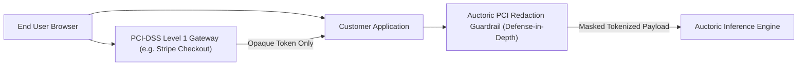

# PCI-DSS Responsibility Matrix & Compliance Summary

**Document Reference:** AUC-SEC-PCI-001  
**Version:** 2.1  
**Effective Date:** `[Insert Effective Date]`  
**Last Updated:** October 22, 2026  
**Classification:** Public / Customer & Auditor Guidance  
**Standard Alignment:** Payment Card Industry Data Security Standard (PCI-DSS) Version 4.0.1 (Merchant SAQ-A Scoping)

---

## 1. Executive Summary & Cardholder Data Scoping

**Auctoric, LLC** ("**Auctoric**") maintains administrative and technical security measures to prevent the unauthorized processing, transmission, or exposure of Cardholder Data (CHD) and Sensitive Authentication Data (SAD).

### 1.1 Auctoric Direct Subscription Billing Scope (Merchant SAQ-A)
For commercial subscription invoicing and platform billing:
* Auctoric utilizes a certified **PCI-DSS Level 1 Payment Service Provider** (e.g., Stripe) to collect and tokenize payment credentials.
* Payment forms utilize secure client-side iFrames (e.g., Stripe Elements).
* **No Primary Account Numbers (PAN), CVV/CVC codes, or magnetic stripe data ever touch, traverse, or reside on Auctoric servers, databases, or container instances.**
* Auctoric’s corporate billing environment is designed and managed to comply with **PCI-DSS Self-Assessment Questionnaire A (SAQ-A)** criteria.

### 1.2 Customer AI Inference & Prompt Processing Scope
When enterprise customers process data through the Auctoric platform:
* **Prohibition on Raw PAN:** Customer prompts containing unencrypted Cardholder Data (PAN) are strictly prohibited under our [Acceptable Use Policy](../legal/acceptable-use-policy.md). Auctoric is not a certified PCI-DSS Service Provider for cardholder processing environments.
* **Defense-in-Depth Redactor:** Auctoric deploys an automated **Edge PCI/PAN Redaction Guardrail** designed to detect and mask card number patterns before payloads reach inference models. This redactor functions as a risk-mitigation security guardrail, not as a certified cardholder data transit gateway.
* **Zero Model Retention:** Prompts are processed in volatile memory enclaves and not retained in model weights, preventing card data persistence.

---

## 2. PCI-DSS v4.0.1 Responsibility Matrix

The following matrix delineates the division of responsibilities between Auctoric, Third-Party Payment Processors, and Customer Deployers under PCI-DSS v4.0.1 control criteria:

| PCI-DSS v4.0.1 Requirement | Payment Processor (Stripe) | Auctoric Platform | Customer Tenant | Guidance & Implementation Notes |
| :--- | :---: | :---: | :---: | :--- |
| **Req 1: Install and Maintain Network Security Controls** | **Sole** (Processor CDE) | **Sole** (Auctoric Cloud) | Customer Managed | Stateful cloud firewalls and Kubernetes network policies isolate Auctoric workloads. |
| **Req 2: Apply Secure Configurations to All System Components** | **Sole** (Processor CDE) | **Sole** (Auctoric Cloud) | Customer Managed | VMs and containers are hardened using CIS Level 2 benchmarks; default vendor credentials are eliminated. |
| **Req 3: Protect Stored Account Data** | **Sole** | Shared | Customer Managed | Auctoric prohibits storage of raw PAN. Redaction guardrails mask card numbers. Payment processor stores tokens. |
| **Req 4: Protect Cardholder Data with Strong Cryptography during Transmission** | **Sole** (Checkout) | **Primary** | Customer Config | TLS 1.3 enforced across all APIs. Customer must ensure client endpoints do not downgrade to deprecated TLS versions. |
| **Req 5: Protect All Systems and Networks from Malicious Software** | **Sole** (Processor CDE) | **Sole** (Auctoric Cloud) | Customer Managed | Runtime behavioral detection and vulnerability scanning active across cloud nodes. |
| **Req 6: Develop and Maintain Secure Systems and Software** | **Sole** (Processor CDE) | **Sole** (Auctoric Cloud) | Customer Managed | Formal SSDLC, automated scanning, and timely flaw remediation. |
| **Req 7: Restrict Access to System Components by Business Need to Know** | **Sole** (Processor CDE) | **Sole** (Auctoric Cloud) | Customer Managed | Least-privilege RBAC enforced across Auctoric infrastructure; Customers manage internal tenant user permissions. |
| **Req 8: Identify Users and Authenticate Access to System Components** | **Sole** (Processor CDE) | **Primary** | Customer Managed | Phishing-resistant MFA (FIDO2) for internal systems; Customer must enforce MFA on tenant logins. |
| **Req 9: Restrict Physical Access to Cardholder Data** | **Sole** (Processor CDE) | Inherited (GCP) | Customer Managed | Data center physical security is inherited from underlying cloud hyperscalers. |
| **Req 10: Log and Monitor All Access to System Components and Cardholder Data** | **Sole** (Processor CDE) | **Primary** | Customer Config | Tamper-resistant audit logs retained for 365 days; Customer reviews tenant access logs. |
| **Req 11: Test Security of Systems and Networks Regularly** | **Sole** (Processor CDE) | **Primary** | Customer Managed | Regular vulnerability scans, internal network reviews, and annual external penetration testing. |
| **Req 12: Support Information Security with Organizational Policies and Programs** | **Sole** (Processor CDE) | **Sole** (Auctoric Org) | Customer Managed | Corporate Information Security Policies, background checks, and personnel training. |

---

## 3. Customer Deployment Architecture Recommendations

To ensure customer applications utilizing Auctoric maintain complete PCI-DSS compliance:

1. **Never transmit unmasked PAN into inference prompts:** Enable the Auctoric PCI Redactor guardrail to replace 16-digit card strings with synthetic tokens (`[CARD_REDACTED_XXXX]`).
2. **Utilize direct hosted tokenization:** Always collect cardholder data directly through payment processor SDKs without passing card numbers through customer backend web servers or Auctoric API payloads.

---

## 4. Compliance Assessment Summary

* **Assessed Entity:** `Auctoric, LLC`
* **Assessment Framework:** PCI-DSS Version 4.0.1
* **Scope Evaluated:** Merchant SAQ-A Self-Assessment (Direct Subscription Billing)
* **Assessment Mode:** Internal Self-Assessment aligned with SAQ-A requirements
* **Status:** **Designed and Managed in Compliance with SAQ-A Criteria**

*(Note: Auctoric maintains SAQ-A compliance documentation for its commercial subscription billing. Auctoric does not issue a Service Provider Attestation of Compliance (AoC) for customer cardholder processing, as raw cardholder data is prohibited on platform inference endpoints.)*
