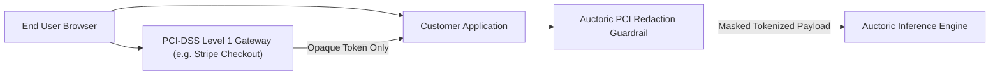

# PCI-DSS Responsibility Matrix & Attestation of Compliance (AoC) Summary

**Document Reference:** AUC-SEC-PCI-001  
**Version:** 2.0  
**Effective Date:** `[Insert Effective Date]`  
**Last Updated:** October 22, 2026  
**Classification:** Public / Customer & Auditor Guidance  
**Standard Alignment:** Payment Card Industry Data Security Standard (PCI-DSS) Version 4.0.1

---

## 1. Executive Summary & Cardholder Data Scoping

**[Auctoric, Inc.]** ("**Auctoric**") maintains a rigorous security posture to prevent the unauthorized processing, transmission, or exposure of Cardholder Data (CHD) and Sensitive Authentication Data (SAD).

### 1.1 Auctoric Direct Subscription Billing Scope
For its commercial subscription invoicing and platform billing:
* Auctoric utilizes a certified **PCI-DSS Level 1 Service Provider** (e.g., Stripe) to collect and tokenize payment credentials.
* Payment forms utilize hosted fields and secure client-side iFrames (e.g., Stripe Elements).
* **No Primary Account Numbers (PAN), CVV/CVC codes, or magnetic stripe data ever touch, traverse, or reside on Auctoric servers, databases, or container instances.**
* Auctoric qualifies for and maintains compliance under **PCI-DSS Self-Assessment Questionnaire A (SAQ-A)**.

### 1.2 Customer AI Inference & Prompt Scoping
When enterprise customers process financial data or customer service interactions through the Auctoric platform:
* Auctoric deploys an automated **Edge PCI/PAN Tokenizer & Redaction Guardrail** that detects and masks 13-to-19 digit card numbers (conforming to the Luhn algorithm) before payloads reach inference models.
* Auctoric’s zero-retention architecture ensures that prompts are not retained in model weights or persistent cache, minimizing the risk of Cardholder Data Environment (CDE) expansion.

---

## 2. PCI-DSS v4.0.1 Responsibility Matrix

The following matrix delineates the division of responsibilities between Auctoric, Third-Party Payment Processors, and Customer Deployers under PCI-DSS v4.0.1:

| PCI-DSS v4.0.1 Requirement | Payment Processor (Stripe) | Auctoric Platform | Customer Tenant | Guidance & Implementation Notes |
| :--- | :---: | :---: | :---: | :--- |
| **Req 1: Install and Maintain Network Security Controls** | **Sole** (Processor CDE) | **Sole** (Auctoric Cloud) | Customer Managed | Auctoric maintains stateful cloud firewalls and Kubernetes network policies isolating workloads. |
| **Req 2: Apply Secure Configurations to All System Components** | **Sole** (Processor CDE) | **Sole** (Auctoric Cloud) | Customer Managed | Auctoric hardens all cloud VMs and containers using CIS Level 2 benchmarks; default vendor passwords are eliminated. |
| **Req 3: Protect Stored Account Data** | **Sole** | Shared | Customer Managed | Auctoric prohibits storage of raw PAN. Redaction guardrails mask card numbers. Payment processor stores tokens. |
| **Req 4: Protect Cardholder Data with Strong Cryptography during Transmission** | **Sole** (Checkout) | **Primary** | Customer Config | Auctoric enforces TLS 1.3 across all APIs. Customer must ensure client endpoints do not downgrade to deprecated TLS versions. |
| **Req 5: Protect All Systems and Networks from Malicious Software** | **Sole** (Processor CDE) | **Sole** (Auctoric Cloud) | Customer Managed | Auctoric deploys automated anti-malware and runtime behavioral detection across cloud nodes. |
| **Req 6: Develop and Maintain Secure Systems and Software** | **Sole** (Processor CDE) | **Sole** (Auctoric Cloud) | Customer Managed | Auctoric enforces a formal SSDLC, scans for vulnerabilities, and remediates Critical flaws within 24 hours. |
| **Req 7: Restrict Access to System Components by Business Need to Know** | **Sole** (Processor CDE) | **Sole** (Auctoric Cloud) | Customer Managed | Least-privilege RBAC enforced across Auctoric infrastructure; Customers manage internal tenant user permissions. |
| **Req 8: Identify Users and Authenticate Access to System Components** | **Sole** (Processor CDE) | **Primary** | Customer Managed | Auctoric mandates phishing-resistant MFA (FIDO2) for internal systems; Customer must enforce MFA on tenant logins. |
| **Req 9: Restrict Physical Access to Cardholder Data** | **Sole** (Processor CDE) | Inherited (AWS/GCP) | Customer Managed | Data center physical security is inherited from underlying ISO 27001 / SOC 2 certified cloud hyperscalers. |
| **Req 10: Log and Monitor All Access to System Components and Cardholder Data** | **Sole** (Processor CDE) | **Primary** | Customer Config | Auctoric maintains tamper-resistant audit logs (WORM storage) for 365 days; Customer reviews tenant access logs. |
| **Req 11: Test Security of Systems and Networks Regularly** | **Sole** (Processor CDE) | **Primary** | Customer Managed | Auctoric runs weekly ASV vulnerability scans, internal network scans, and annual external penetration testing. |
| **Req 12: Support Information Security with Organizational Policies and Programs** | **Sole** (Processor CDE) | **Sole** (Auctoric Org) | Customer Managed | Auctoric enforces corporate Information Security Policies, background checks, and annual personnel training. |

---

## 3. Customer Deployment Architecture Recommendations

To ensure customer applications utilizing Auctoric maintain complete PCI-DSS compliance:

1. **Never transmit unmasked PAN into inference prompts:** Enable the Auctoric PCI Redactor guardrail to replace 16-digit card strings with synthetic tokens (`[CARD_REDACTED_XXXX]`).
2. **Utilize direct hosted tokenization:** Always collect cardholder data directly through payment processor SDKs without passing card numbers through customer backend web servers or Auctoric API payloads.

---

## 4. Summary of Attestation of Compliance (AoC)

* **Merchant / Service Provider:** `[Auctoric, Inc.]`
* **Assessment Standard:** PCI-DSS Version 4.0.1
* **Scope Evaluated:** SAQ-A Merchant / Governed AI Cloud API Provider
* **Assessed By:** Internal Security Compliance Team / Qualified Security Assessor (QSA) `[Name of QSA Firm / Assessor]`
* **Assessment Date:** `[Insert Date]`
* **Validation Status:** **COMPLIANT**

Copies of the official signed Attestation of Compliance (AoC) are available to enterprise customers under active NDA upon request at `[compliance@auctoric.com]`.
