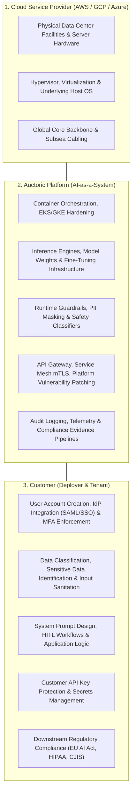

# Shared Responsibility Matrix

**Document Reference:** AUC-SEC-SRM-001  
**Version:** 2.2  
**Effective Date:** `[Insert Effective Date]`  
**Last Updated:** October 22, 2026  
**Classification:** Public / Customer Guidance  
**Standards Frameworks:** SOC 2 | ISO/IEC 27001 | ISO/IEC 42001 | NIST AI RMF | FedRAMP / CMMC

---

## 1. Overview and Architecture Principles

Security and compliance within the **Auctoric Governed AI Platform** operate under a **Shared Responsibility Model**. Ensuring end-to-end security, data protection, and regulatory alignment is a collaborative obligation shared among:

1. **Cloud Service Provider (CSP):** Underlying hyperscaler infrastructure (AWS, GCP, Azure) providing physical facilities, server hardware, virtualization layers, and global network backbones.
2. **Auctoric (AI Platform Provider):** Software layer, model serving runtimes, AI safety guardrails, orchestration pipelines, API endpoints, encryption keys, and container infrastructure.
3. **Customer (Deployer / Enterprise Tenant):** User identity provisioning, prompt crafting, application data classification, client secrets management, human oversight, and downstream compliance.

---

## 2. Comprehensive Shared Responsibility Matrix

| Domain / Control Area | Cloud Provider (CSP) | Auctoric Platform | Customer (Tenant) | Responsibility Summary & Operational Guidance |
| :--- | :---: | :---: | :---: | :--- |
| **Physical & Environmental** | **Sole** | Inherited | Inherited | CSP provides biometric data center access, UPS power, HVAC, and physical camera monitoring. |
| **Hypervisor & Host Isolation** | **Sole** | Inherited | Inherited | CSP guarantees multi-tenant hypervisor isolation and firmware security. |
| **Network Perimeter (DDoS / Edge)** | Shared | **Primary** | Customer Config | CSP provides L3/L4 DDoS mitigation; Auctoric configures WAF, TLS 1.3 termination, and rate limits; Customer configures custom IP allowlists if required. |
| **Platform Microservices & OS** | Inherited | **Sole** | N/A | Auctoric hardens container images (distroless), applies weekly OS patches, and enforces zero-root execution. |
| **AI Foundation Model Weights** | Inherited | **Sole** | N/A | Auctoric secures model artifacts with cryptographic hash verification and integrity checks against unauthorized weight tampering. |
| **AI Safety Guardrails & Filtering** | Inherited | **Primary** | Shared | Auctoric provides real-time PII redaction and prompt toxicity classifiers; Customer configures domain-specific blocklists and tolerance thresholds. |
| **Prompt Injection Defense** | Inherited | **Shared** | **Shared** | Auctoric deploys heuristic & neural prompt injection filters; Customer must sanitize input parameters and prevent direct concatenated user prompts in system roles. |
| **Tenant Data Isolation & RAG** | Inherited | **Primary** | Shared | Auctoric provides cryptographically partitioned vector indexes; Customer manages index access permissions and document ingestion scope. |
| **Data Encryption at Rest** | Shared | **Primary** | Shared | CSP provides KMS hardware; Auctoric enforces AES-256 by default; Customer may supply Customer-Managed Encryption Keys (CMEK). |
| **Data Encryption in Transit** | Shared | **Sole** | Customer Config | Auctoric enforces TLS 1.3 across all endpoints; Customer must ensure their client SDKs and API libraries do not disable TLS verification. |
| **Identity & Access Management (IAM)**| Inherited | Shared | **Primary** | Auctoric provides SSO/SAML integrations and RBAC tools; Customer must enforce corporate MFA, manage user provisioning, and deprovision departed staff. |
| **API Secret & Token Management** | Inherited | Shared | **Primary** | Auctoric securely hashes and stores credentials; Customer must never hardcode API keys in frontend code, git repositories, or client bundles. |
| **Human-in-the-Loop (HITL) Controls** | Inherited | Shared | **Primary** | Auctoric provides audit logs and HITL intervention APIs; Customer must staff and execute human review for High-Risk automated decisions. |
| **End-User Consent & Privacy Rights** | Inherited | Shared | **Sole** | Customer is the Data Controller responsible for collecting valid consent and responding to consumer data subject requests (DSARs). |
| **Backup & Business Continuity** | Shared | **Primary** | Shared | Auctoric maintains multi-region backup pipelines (RPO < 1h, RTO < 4h); Customer is responsible for maintaining local copies of raw source documents. |

---

## 3. Detailed AI & Large Language Model (LLM) Risk Responsibilities

The OWASP Top 10 for Large Language Applications requires specific shared actions:

### 3.1 LLM01: Prompt Injection
* **Auctoric Responsibility:** Implement real-time multi-stage injection classifiers, inspect semantic embedding anomalies, and isolate system prompts from user prompt execution blocks.
* **Customer Responsibility:** Implement input length validation, escape untrusted variables, and architect workflows using least-privilege agent tools (e.g., read-only database connections).

### 3.2 LLM02: Sensitive Information Disclosure
* **Auctoric Responsibility:** Offer automated client-side and edge PII tokenization/masking filters before inference dispatch; guarantee zero model retention for public training.
* **Customer Responsibility:** Classify sensitive datasets prior to ingestion; avoid passing unencrypted credentials, proprietary trade secrets, or unmasked PHI into general prompts.

### 3.3 LLM06: Excessive Agency & Autonomous Tool Execution
* **Auctoric Responsibility:** Provide deterministic guardrails, function-call permission scopes, and rate limits on tool execution.
* **Customer Responsibility:** Enforce human approval gates before downstream agents execute irreversible actions (e.g., executing financial wires, deleting database records, issuing formal legal notices).

---

## 4. Compliance RACI Matrix

* **R (Responsible):** The party executing the activity.
* **A (Accountable):** The party with ultimate decision ownership.
* **C (Consulted):** The party providing input or technical resources.
* **I (Informed):** The party kept updated on status.

| Compliance Task | Cloud Provider | Auctoric | Customer |
| :--- | :---: | :---: | :---: |
| SOC 2 Type II Infrastructure Attestation | R/A | I | I |
| SOC 2 Type II Platform Application Attestation | I | R/A | I |
| Customer Downstream Application SOC 2 / ISO Certification | I | C | R/A |
| EU AI Act Conformity Assessment (High-Risk Systems) | I | R (System) | A (Deployment) |
| HIPAA BAA Execution | I | R/A | R/A |
| User Credential Revocation upon Employee Departure | I | I | R/A |
| Incident Response for Cloud Infrastructure Outage | R/A | C | I |
| Incident Response for Model Inference Vulnerability | I | R/A | C/I |
| Customer Data Subject Access Request (DSAR) Fulfillment | I | C | R/A |

---

## 5. Contact & Support

For assistance regarding shared controls, architecture reviews, or compliance scoping:
* **Compliance Engineering:** `[compliance-eng@auctoric.com]`
* **Trust & Security Portal:** `[https://trust.auctoric.com]`
