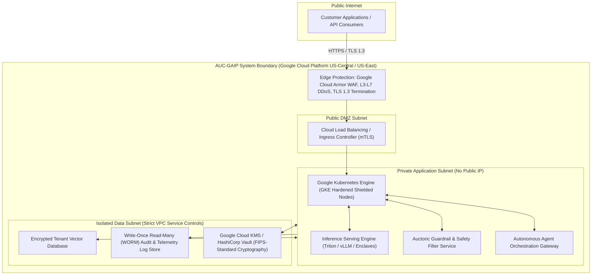

# System Security Plan (SSP) Summary

**Document Reference:** AUC-SEC-SSP-001  
**Version:** 3.2  
**Effective Date:** `[Insert Effective Date]`  
**Last Updated:** October 22, 2026  
**Classification:** Proprietary / Customer & Auditor Access Only  
**Baseline Frameworks:** NIST SP 800-53 Rev. 5 (Moderate Baseline Control Alignment) | FedRAMP Moderate Equivalent Criteria | SOC 2 Type II Alignment

---

## 1. System Identification & Metadata

* **System Name:** Auctoric Governed AI Platform
* **System Acronym:** AUC-GAIP
* **System Unique Identifier (UID):** `[AUC-SYS-0428]`
* **System Categorization (FIPS 199 / FIPS 200 Baseline):**
  * **Confidentiality:** Moderate
  * **Integrity:** Moderate
  * **Availability:** Moderate
  * **Overall Target Security Impact Level:** **MODERATE**
* **System Owner:** Chief Technology Officer (`[cto@auctoric.ai]`)
* **Information System Security Officer (ISSO):** Director of Security Operations (`[security-ops@auctoric.ai]`)
* **Authorizing Official (AO):** Chief Information Security Officer (`[ciso@auctoric.ai]`)

---

## 2. System Overview and Operational Purpose

The **Auctoric Governed AI Platform (AUC-GAIP)** is a cloud-native Software-as-a-Service (SaaS) and Platform-as-a-Service (PaaS) solution engineered to provide secure, monitored, and compliant Artificial Intelligence workflows.

AUC-GAIP facilitates:
1. Low-latency, privacy-preserving LLM inference orchestration;
2. Real-time adversarial guardrail enforcement, prompt sanitization, and PII tokenization;
3. Isolated retrieval-augmented generation (RAG) vector embeddings and indexing;
4. Autonomous agentic coordination with cryptographic audit telemetry and human oversight gates.

---

## 3. System Boundary & Architecture Overview

The production architecture is deployed on **Google Cloud Platform (GCP)** leveraging hardened Google Kubernetes Engine (GKE) clusters, Cloud KMS, and Cloud Armor:

### 3.1 Network Isolation and Boundary Protections
* The system authorization boundary includes all virtual instances, GKE container nodes, managed database clusters, and persistent object stores deployed across dedicated virtual private clouds (VPCs) with VPC Service Controls.
* Zero external direct SSH or administrative ingress is permitted; internal maintenance is mediated via hardened bastion hosts requiring FIDO2 WebAuthn authentication.
* External connections communicate exclusively over TLS 1.3 with forward secrecy.

---

## 4. Key NIST SP 800-53 Control Family Summaries

AUC-GAIP controls are designed and implemented to align with the NIST SP 800-53 Rev. 5 Moderate baseline:

### 4.1 Access Control (AC) & Identification and Authentication (IA)
* **AC-2 / IA-2 (Multi-Factor Authentication):** Enforced across all internal administrative consoles and platform dashboards. Phishing-resistant FIDO2 hardware tokens are required for all production access.
* **AC-3 / AC-6 (Least Privilege & RBAC):** Ephemeral Just-In-Time (JIT) access grants valid for a maximum of 4 hours, subject to manager ticket approval.
* **AC-17 (Remote Access):** Remote engineering access requires cryptographic WireGuard VPN tunnels with continuous device posture assessment.

### 4.2 Audit and Accountability (AU)
* **AU-2 / AU-6 (Audit Logging & Review):** Complete capture of administrative logins, API token invocations, prompt safety alerts, and configuration adjustments.
* **AU-9 (Protection of Audit Information):** Operational logs are streamed in real-time to Google Cloud Storage buckets configured with Bucket Lock (Retention Policy in Compliance Mode), preventing deletion or alteration for 365 days.

### 4.3 Configuration Management (CM)
* **CM-2 / CM-3 (Baseline & Change Control):** Infrastructure as Code (Terraform) maintained in Git with dual-peer review requirements.
* **CM-8 (Information System Component Inventory):** Automated continuous discovery of all cloud resources via Google Cloud Asset Inventory.

### 4.4 Contingency Planning (CP) & Incident Response (IR)
* **CP-9 / CP-10 (Backups & Recovery Testing):** Automated daily snapshots with cross-region replication. Tested regularly.
* **IR-4 / IR-6 (Incident Handling & Reporting):** Dedicated incident response team adhering to NIST SP 800-61 Revision 3 standards. Security breaches impacting personal data are reported to affected customers within 48 hours.

### 4.5 System and Communications Protection (SC)
* **SC-8 / SC-13 (Transmission & Storage Cryptography):** Cryptographic modules conforming to FIPS standards. AES-256 for all stored data; TLS 1.3 for communications.
* **SC-7 (Boundary Protection):** Cloud Armor, stateful network firewalls, microsegmentation security groups, and automated egress traffic filtering.

### 4.6 System and Information Integrity (SI)
* **SI-2 / SI-4 (Flaw Remediation & Monitoring):** Automated container image vulnerability scanning, weekly kernel patching, and continuous SIEM monitoring with automated intrusion prevention.

---

## 5. Continuous Monitoring (ConMon) Strategy

Auctoric operates an internal Continuous Monitoring program designed to verify ongoing alignment with Moderate baseline criteria:
1. **Automated Vulnerability Scanning:** Automated scans across container registries and cloud instances.
2. **Configuration Drift Detection:** Continuous automated checks against CIS Benchmarks (Level 2).
3. **Independent Penetration Testing:** Annual white-box testing conducted by external offensive security firms.
4. **Plan of Action and Milestones (POA&M):** All identified findings are logged in an internal tracking system with mandatory remediation timelines.

---

## 6. Document Purpose & Administrative Alignment

This System Security Plan Summary describes the architectural, administrative, and technical safeguards designed and implemented across the Auctoric Governed AI Platform. This document provides an operational security description and does not constitute an agency authorization to operate (ATO) or external government certification.

* **Authorizing Official:** `[CISO Name, CISSP / CISM]`  
* **Title:** Chief Information Security Officer  
* **Signature:** ___________________________  
* **Date:** `[Insert Date]`
