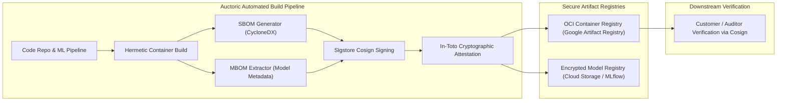

# SBOM and MBOM Architecture Guidelines

**Document Reference:** AUC-TECH-BOM-001  
**Version:** 2.1  
**Effective Date:** `[Insert Effective Date]`  
**Last Updated:** October 22, 2026  
**Classification:** Technical Standard / Engineering Reference  
**Standards Alignment:** Executive Order 14028 | NTIA Minimum Elements | CycloneDX v1.6 | SPDX 3.0 | NIST AI RMF

---

## 1. Overview and Rationale

In modern cloud-native and AI-driven platforms, supply chain transparency is a core security prerequisite. **Auctoric, LLC** ("**Auctoric**") enforces supply chain visibility across both classical software dependencies and artificial intelligence models through:

1. **Software Bill of Materials (SBOM):** Machine-readable inventory of software components, third-party libraries, container layers, and licenses.
2. **Model Bill of Materials (MBOM):** Structured inventory of machine learning models, weights, training dataset provenance, tokenizers, fine-tuning checkpoints, and evaluation benchmarks.

These guidelines define the generation, signing, validation, and publication standards for Auctoric deliverables.

---

## 2. Supply Chain Architecture & Lifecycle



---

## 3. Software Bill of Materials (SBOM) Specification

### 3.1 Standard & Schema Format
* **Mandatory Format:** **CycloneDX v1.6 JSON** (Primary) or **SPDX 3.0 JSON** (Secondary upon federal requirement).
* **Compliance Alignment:** Fulfills the National Telecommunications and Information Administration (NTIA) Minimum Elements for an SBOM under Executive Order 14028.

### 3.2 Required Metadata Fields
Every generated SBOM must include:
* **Author / Supplier:** `Auctoric, LLC`
* **Component Name & Version:** Specific semantic release (e.g., `auctoric-agent-runtime:v2.4.1`)
* **Package URL (PURL):** Canonical identifier (e.g., `pkg:golang/github.com/gin-gonic/gin@v1.9.1`)
* **Cryptographic Hashes:** SHA-256 for all binaries and dependency files
* **Dependency Relationships:** Direct vs transitive dependency tree
* **License Information:** SPDX license expression (e.g., `Apache-2.0`, `MIT`)

---

## 4. Model Bill of Materials (MBOM) Specification

Artificial intelligence models introduce unique supply chain risks, such as backdoors, data poisoning, and licensing contagion. Auctoric extends CycloneDX machine learning schema standards to produce verifiable MBOMs.

### 4.1 Required MBOM Metadata Fields

| Field Category | Attribute | Description & Validation Rule |
| :--- | :--- | :--- |
| **Model Identity** | `model-name`, `architecture`, `version` | Name, foundational architecture (e.g., Transformer, MoE), parameter size (e.g., 70B). |
| **Base Weights & Hashes** | `checkpoint-sha256`, `format` | Cryptographic SHA-256 hash of model tensors (Safetensors / GGUF). Pickle files are strictly banned. |
| **Dataset Lineage** | `pre-training-corpus`, `fine-tuning-data` | Data provenance identifiers, curation dates, synthetic ratio, licensing terms where available from upstream providers. |
| **Quantization & Compute** | `quantization-level`, `precision` | Precision format (FP16, BF16, FP8, INT4 AWQ), target hardware accelerator (TPU v5 / NVIDIA H100). |
| **Tokenizer Configuration** | `vocab-size`, `tokenizer-hash` | Vocabulary size, special token definitions (BOS, EOS, PAD), tokenizer checksum. |
| **Alignment & Safety** | `alignment-technique`, `guardrails` | Fine-tuning method (RLHF, DPO, KTO), embedded system prompt hash, benchmark safety scores. |

### 4.2 Example CycloneDX v1.6 MBOM JSON Snippet
```json
{
  "$schema": "http://cyclonedx.org/schema/bom-1.6.schema.json",
  "bomFormat": "CycloneDX",
  "specVersion": "1.6",
  "serialNumber": "urn:uuid:3e671687-395b-41f5-a30f-a58921a69b79",
  "version": 1,
  "metadata": {
    "timestamp": "2026-10-22T08:00:00Z",
    "component": {
      "type": "machine-learning-model",
      "name": "auctoric-governance-evaluator-70b",
      "version": "v1.4.0",
      "hashes": [
        {
          "alg": "SHA-256",
          "content": "e3b0c44298fc1c149afbf4c8996fb92427ae41e4649b934ca495991b7852b855"
        }
      ],
      "modelCard": {
        "modelParameters": {
          "approach": { "type": "supervised" },
          "task": "classification-and-reasoning",
          "architectureFamily": "Transformer-Decoder",
          "parameters": 70000000000
        },
        "quantitativeAnalysis": {
          "performanceMetrics": [
            { "type": "toxicity-benchmark", "value": "0.001" },
            { "type": "prompt-injection-resistance", "value": "99.4%" }
          ]
        }
      }
    }
  }
}
```

---

## 5. Build Pipeline Automation and Verification

1. **Automated Generation:** Generated during CI release builds using `syft` and Auctoric’s `mbom-extractor`.
2. **Cryptographic Signing:** Signed using **Sigstore Cosign** with automated keyless OIDC signing tied to Auctoric’s corporate GitHub organization.
3. **In-Toto Attestations:** Build provenance attestations (SLSA Level 3 criteria) stored directly in the OCI registry alongside container artifacts.
4. **Customer Verification:** Enterprise customers can verify release integrity using the public Cosign verification key:
   ```bash
   cosign verify --key https://auctoric.ai/security/cosign.pub registry.auctoric.ai/platform/engine:v2.4
   ```

---

## 6. Access and Customer Distribution

Enterprise customers and auditors may access current SBOM and MBOM inventories:
* **Via API:** `GET /api/v1/compliance/bom?artifact_id={ID}`
* **Via Portal:** Downloadable through the Auctoric Trust Portal (`[https://trust.auctoric.ai/bom]`)
* **Security Inquiries:** `[supply-chain-security@auctoric.ai]`
