# Secure Software Development Lifecycle (SSDLC) Policy

**Document Reference:** AUC-TECH-SSDLC-001  
**Version:** 3.0  
**Effective Date:** `[Insert Effective Date]`  
**Last Updated:** October 22, 2026  
**Classification:** Internal / Engineering Standard  
**Framework Alignment:** NIST SP 800-218 (SSDF v1.1) | OWASP Software Assurance Maturity Model (SAMM v2.0) | OWASP Top 10:2021 | OWASP Top 10 for LLMs v2.0

---

## 1. Purpose and Philosophy

The Secure Software Development Lifecycle ("**SSDLC**") Policy establishes mandatory engineering practices, automated security gates, and governance controls implemented by **[Auctoric, Inc.]** ("**Auctoric**").

Security is an integrated, continuous engineering discipline—not an afterthought. Auctoric embraces **"Shift-Left Security"** and **"Continuous AI Safety Verification"**, ensuring that all code, container images, foundation model orchestrations, and autonomous agent capabilities are hardened throughout conception, development, testing, and production runtime.

---

## 2. SSDLC Phased Governance Framework

```mermaid
flowchart LR
    Phase1["1. Requirements & Threat Modeling"] --> Phase2["2. Secure Design & AI Governance Review"]
    Phase2 --> Phase3["3. Implementation & Secure Coding"]
    Phase3 --> Phase4["4. Automated CI/CD Gates (SAST/SCA/DAST)"]
    Phase4 --> Phase5["5. Adversarial Red Teaming & Verification"]
    Phase5 --> Phase6["6. Immutable Release & Attestation"]
    Phase6 --> Phase7["7. Runtime Defense & Continuous Monitoring"]
```

---

## 3. Phase-by-Phase Mandatory Requirements

### Phase 1: Planning, Requirements & Threat Modeling (NIST SSDF: PW.1, PW.2)
1. **Security & Privacy User Stories:** Every product epic must define explicit non-functional security requirements (e.g., encryption bounds, authentication boundaries, tenant isolation criteria).
2. **STRIDE Threat Modeling:** Formal STRIDE (Spoofing, Tampering, Repudiation, Information Disclosure, Denial of Service, Elevation of Privilege) threat modeling is required for any new architectural component or API endpoint.
3. **AI Threat Vector Assessment:** Machine learning pipelines must model AI-specific failure modes, including prompt injection, model evasion, data poisoning, and unauthorized tool invocation.

### Phase 2: Secure Architecture & Design (NIST SSDF: PW.3, PW.4)
1. **Least-Privilege API Design:** All microservice communication must authenticate via mutual TLS (mTLS) with cryptographically scoped workload identities (SPIFFE/SPIRE).
2. **Cryptographic Validation:** No proprietary or non-standard cryptographic primitives. All algorithms must conform to NIST FIPS 140-3 standards.
3. **AI Safety by Design:** Agentic execution threads must enforce deterministic parameter validation schemas and human-in-the-loop approval hooks for high-risk actions.

### Phase 3: Secure Implementation & Coding Standards (NIST SSDF: PW.5, PW.6)
1. **Source Code Hygiene:** Developers must adhere to language-specific secure coding standards (e.g., OWASP Secure Coding Practices, Google Python/Go Style Guides).
2. **Secrets Prevention:** Hardcoded API keys, certificates, private keys, or credentials in source code are strictly forbidden. Git hooks (`pre-commit` with TruffleHog / Gitleaks) enforce pre-push prevention.
3. **Version Control Controls:**
   * Direct pushes to `main` and release branches are cryptographically blocked.
   * All pull requests (PRs) require a minimum of two (2) independent peer code reviews.
   * Signed commits (GPG / SSH) are enforced across all repositories.

### Phase 4: Automated CI/CD Testing & Quality Gates (NIST SSDF: RV.1, RV.2)
Every commit to the code repository triggers an automated pipeline enforcing blocking security gates:

| Security Gate / Tooling | Target Domain | Blocking Criteria |
| :--- | :--- | :--- |
| **Static Application Security Testing (SAST)** (e.g., Semgrep, SonarQube) | Source code logic | Zero Critical or High vulnerabilities. |
| **Software Composition Analysis (SCA)** (e.g., Snyk, Dependabot) | Third-party dependencies & libraries | Zero known exploitable CVEs with CVSS >= 7.0. |
| **Model Bill of Materials (MBOM)** (Auctoric Validator) | Foundation models, tokenizer configs | Unsigned weights, unverified checksums block build. |
| **Container Image Scanning** (e.g., Trivy, Aqua) | Docker / OCI container layers | Zero Critical OS vulnerabilities; distroless base images mandatory. |
| **Static Prompt Injection Regression** | LLM prompt templates | Failures against standard adversarial prompt test suites block merge. |

### Phase 5: Adversarial Verification & Red Teaming (NIST SSDF: RV.3)
1. **Dynamic Application Security Testing (DAST):** Automated OWASP ZAP / Burp Enterprise scans against staging environments.
2. **Adversarial AI Red Teaming:** Dedicated AI security engineers test LLM endpoints againstjailbreaks, system prompt extraction, indirect prompt injection, and excessive agency exploitation (OWASP LLM Top 10).
3. **External Penetration Testing:** Annual independent third-party white-box security assessments.

### Phase 6: Release, Packaging & Attestation (NIST SSDF: PS.1, PS.3)
1. **SLSA Level 3 Attestation:** Production container images are built via hermetic, reproducible CI pipelines.
2. **Cryptographic Artifact Signing:** Container images and model weights are signed using Sigstore (Cosign) before publication to production registries.
3. **Automated SBOM/MBOM Generation:** Detailed Software & Model Bills of Materials generated in CycloneDX v1.6 format.

### Phase 7: Production Operations & Runtime Protection (NIST SSDF: PO.1, PO.2)
1. **Runtime Container Security:** eBPF-based runtime monitoring (e.g., Cilium Tetragon / Falco) monitoring unauthorized process execution or unexpected network egress.
2. **Automated Incident Response:** Integration with SIEM / SOAR pipelines for immediate container quarantine upon anomalous activity.

---

## 4. Developer Training & Culture

* **Annual Secure Development Training:** Engineers must complete annual secure development curriculum covering OWASP Top 10, memory safety, and LLM adversarial engineering.
* **Security Champions Program:** Embedded security champions in each product squad act as primary liaisons with the central security engineering team.

---

## 5. Exceptions and Deviation Governance

Any temporary deviation from this policy (e.g., delayed patching of an upstream dependency with no available fix) requires an approved **Security Exception Waiver**:
* Must document compensating technical controls;
* Maximum valid duration: thirty (30) days;
* Requires dual sign-off from the Tech Lead and Chief Information Security Officer (CISO).
